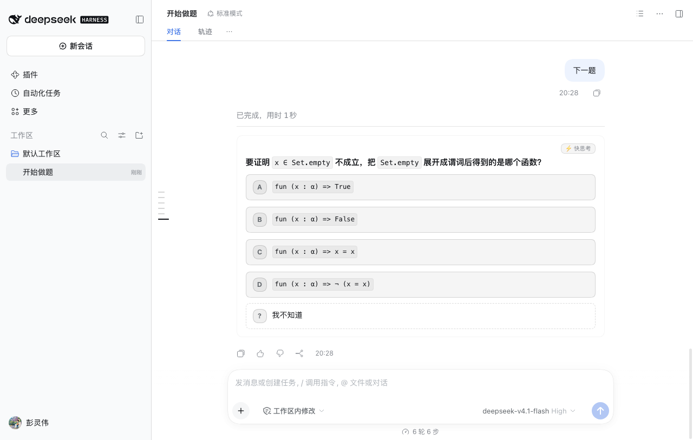
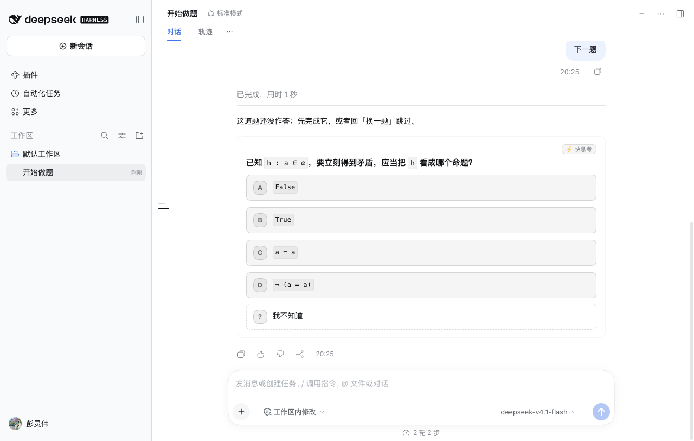
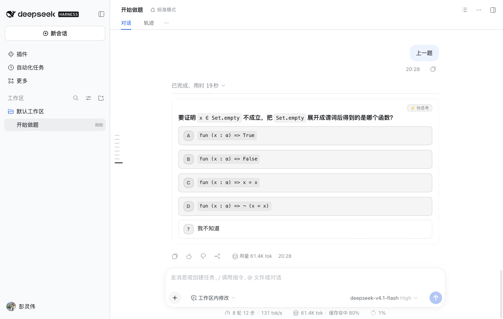
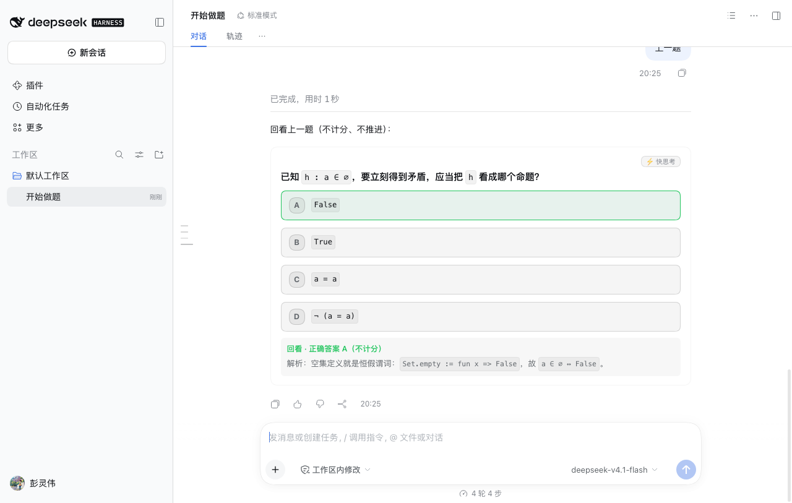

# #110 快路径上下文导航：Before / After 证据

## 结论

| 场景 | Before（`main` @ `cac29fef`） | After（本分支） |
|---|---|---|
| 当前题未作答时说「下一题」 | 直接推进到下一题（题目被跳过） | 重发**同一道**当前题，并提示「这道题还没作答」 |
| 说「上一题」 | 不是快路径命令，落到慢模型（本次 19 秒，返回普通题卡）；**没有回顾卡** | 立即返回**只读回顾卡**：正确选项绿色高亮 + `why` 解析，不计分、不推进 |

## 环境与流程

- **Before**：`git worktree` 从 `origin/main` @ `cac29fef` 检出，插件目录直接挂到隔离 profile。
- **After**：本分支的 `dsh/plugins/sokonanoda-dsh`（提交见 PR）。
- 两个隔离的 DSH Web 实例（`DSH_HOME`、`SOKO_DSH_DATA` 各自独立；插件数据目录独立，
  避免做题记录互相污染），同一版本、同一 1280×813 视口、默认浅色主题。
- 两边都从**全新**做题状态开始，走完全相同的脚本：
  1. `/sokonanoda-fast-think on`
  2. `开始做题` → 第一题（两边相同：`I.1.empty-1`）
  3. `下一题` → 截图 `*-next-unanswered.png`
  4. `换一题` → 强制推进到新题
  5. `上一题` → 截图 `*-back-request.png` / `*-back-review.png`
- 截图是真实运行的 DSH Web UI（headless Chrome 经 CDP 操作 composer），不是 mock。
  每张图配一份 `*.dom.json`，记录当时页面里 `[data-learn-card]` 的实际文本与
  `review` / `correct` 标记。

## 证据

### 1. 未作答题不推进

| Before | After |
|---|---|
|  |  |

**Before**：点击/输入「下一题」后，第二张卡的题干从
`已知 h : a ∈ ∅…` 变成 `要证明 x ∈ Set.empty 不成立…`（`before-next-unanswered.dom.json`）。
**After**：第二张卡与第一张题干完全相同，且上方出现
「这道题还没作答；先完成它，或者回「换一题」跳过。」（`after-next-unanswered.dom.json`）。

### 2. 只读回顾上一题

| Before | After |
|---|---|
|  |  |

**Before**：「上一题」不被快路径识别，落到慢模型（页面显示「已完成 · 用时 19 秒」），
最后返回的仍是普通题卡，没有回顾卡、没有正确答案高亮
（`before-back-request.dom.json` 里最后一张卡 `review: false`、`correct: []`）。
**After**：立即返回回顾卡：`review: true`、`correct: ["A False"]`，选项行
`data-pickable` / `onClick` 均不存在，「我不知道」行也不渲染；卡片底部显示
「回看 · 正确答案 A（不计分）」+「解析：空集定义就是恒假谓词…」。
浏览器实测计算样式：正确选项 `background: rgba(15, 123, 74, 0.1)`、
`border-color: rgb(34, 197, 94)`（`after-back-review.dom.json`）。

## 限制

- Host 半（`quiz-proxy.mjs`）改动需要**重启 DSH** 才生效；只改 `client.js` 时由 client HMR 热更新。
- 回顾卡的数据来源：优先 `last_decision.probe.continuity.prevQid`，退化到进程内最近发题栈，
  再退化到 `history` 末条 + 静态题库 `questions.json`。进程重启后前两级可能为空，
  但静态题库兜底仍可回顾已答的上一题。
