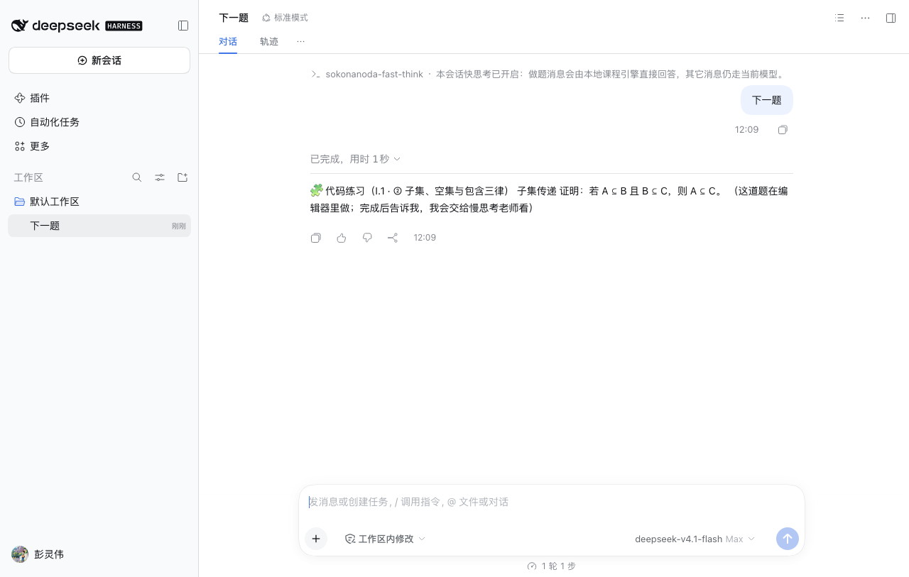
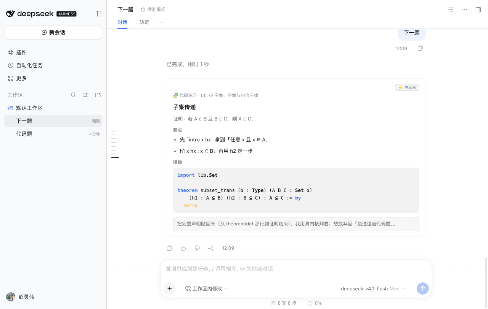
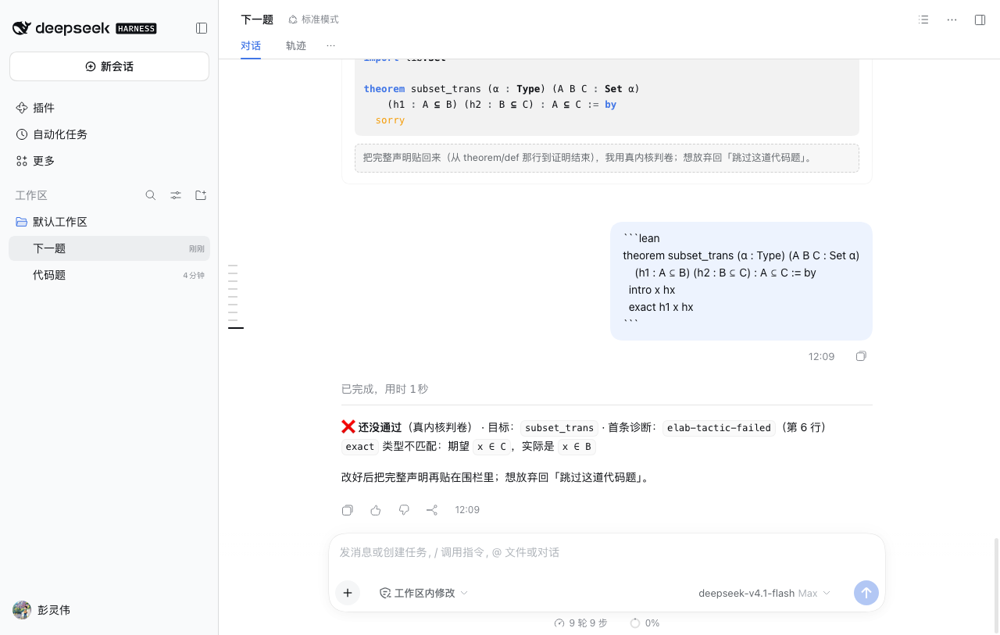
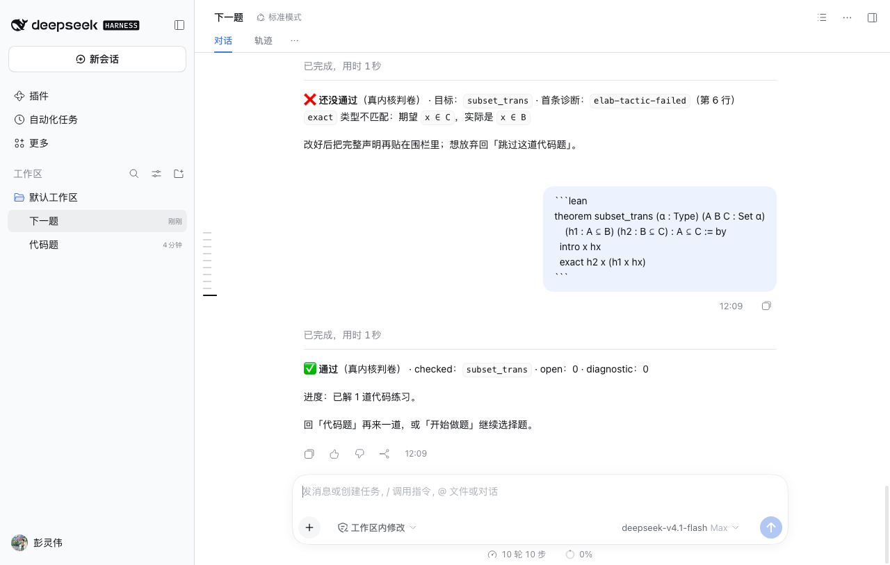
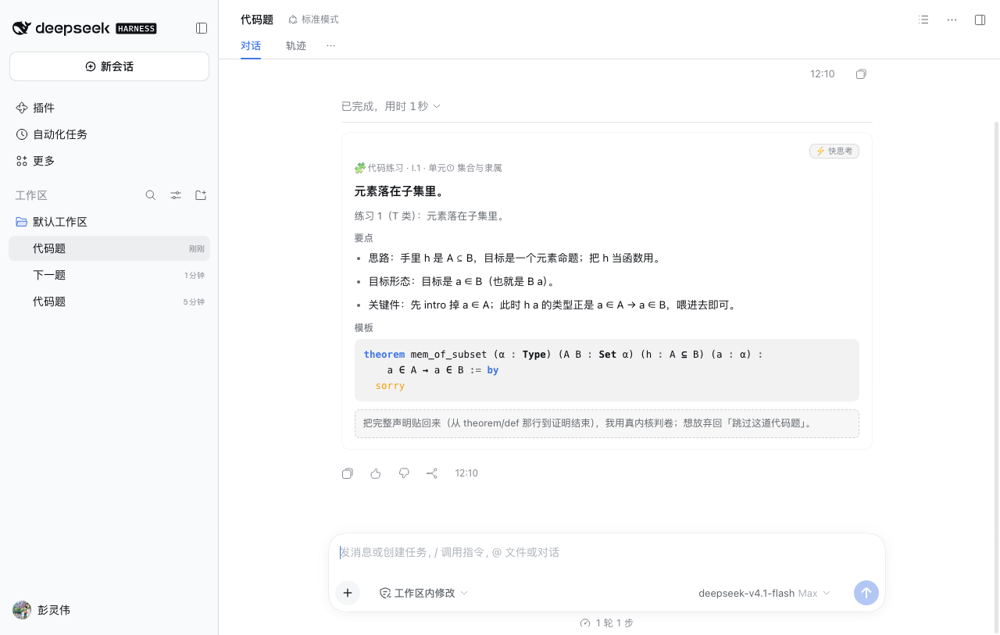

# C9.4 代码题卡片 + 真内核判卷：Before / After 证据

## 结论

| 场景（同一 1280×813 视口、浅色主题、中文 UI） | Before（`main` @ `8892a2b8`） | After（本分支） |
|---|---|---|
| 已发出代码练习题 → 用户回「下一题」 | 一行纯文本：`🧩 代码练习（I.1 · ② 子集、空集与包含三律） 子集传递 证明：… （这道题在编辑器里做；完成后告诉我，我会交给慢思考老师看）` | 代码练习卡：题干、**提示**、带 `sorry` 的**可信模板**、提交说明，右上角 `⚡ 快思考` |
| 提交围栏代码 | 不判卷：消息落到慢路径模型（本机配额已用尽，截图是模型路径的 QUOTA 失败，**不是内核结果**） | 本地 `compose.py` / `scripts/soko grade --json` 真内核判卷：错误显示首条诊断；改对后显示 checked / open / diagnostic 与进度 |
| 数据来源 | 只能恢复引擎小题库的 6 道（`codeEvery=0` 时不发代码题） | 同一状态恢复 + 新增「代码题」从 `courses/exercise-dataset`（默认 set-theory）发题 |

## 环境与流程

- **Before**：`git worktree` 从 `origin/main` @ `8892a2b8` 检出，插件目录直接挂到隔离 DSH profile。
- **After**：本分支的 `dsh/plugins/sokonanoda-dsh`（提交见 PR）。
- 两个隔离的 DSH Web 实例（`DSH_HOME`、`SOKO_DSH_DATA` 各自独立；端口 3987/3988），
  同一版本 DSH、同一 1280×813 视口、默认浅色主题、中文。
- 两边都从**同一份 seeded 引擎状态**开始：`{issued_code: "code.i1.subset-trans"}`
  （引擎小题库的题，两边都能恢复；这样比较的是同一道题、同一场景）。
- 走完全相同的脚本：
  1. `/sokonanoda-fast-think on`
  2. `下一题` → 截图 `before-code-card.png` / `after-code-card.png`
  3. After 继续：提交错误证明 → `after-code-fail.png`；再提交正确证明 → `after-code-pass.png`
  4. Before 继续：提交同一份正确证明 → `before-code-submit.png`（模型路径，配额耗尽）
- After 额外截一张 `after-dataset-card.png`：「代码题」从数据集发的第一道
  `set-theory/I.1/unit01-sets-membership/mem_of_subset`（题干/提示/模板）。

截图是真实运行的 DSH Web UI（headless Chrome 经 CDP 操作 composer），不是 mock；
状态来自真实课程引擎与真实内核。

## 证据

### 1. 代码练习卡片（同一道 `code.i1.subset-trans`）

| Before | After |
|---|---|
|  |  |

**Before**：只有 chapter/unit/title/prompt 一行，正文把任务交给慢思考老师
（`（这道题在编辑器里做；完成后告诉我，我会交给慢思考老师看）`）。
**After**：同样的题渲染为卡片：提示（`先 intro x hx…`）、`import lib.Set` + 带
`sorry` 的模板、提交说明；`⚡ 快思考` 标记表明这张卡来自本地引擎。

### 2. 真内核判卷（After）

| 错误提交 | 正确提交 |
|---|---|
|  |  |

**错误**：`❌ 还没通过（真内核判卷）` + 目标 `subset_trans` +
`elab-tactic-failed`（第 6 行）`exact` 类型不匹配：期望 `x ∈ C`，实际是 `x ∈ B`；
`issued_code` 保持不变，可同题重试。
**正确**：`✅ 通过（真内核判卷）` + `checked：subset_trans · open：0 · diagnostic：0` +
`进度：已解 1 道代码练习。`（`mark-code` 记录）。

### 3. After：数据集代码题卡

「代码题」→ `engine.py code-next` 从 `courses/exercise-dataset` 发第一道具名练习
（`mem_of_subset`）；题目内容来自数据集，组装/判卷走 `compose.py` +
`scripts/soko grade --root courses/set-theory --json`。

## 限制（如实记录）

- **Before 的提交路径没有内核判卷**：同一份围栏代码在 `origin/main` 上落到慢模型；
  本次 Before 实例的 provider 配额已用尽，所以 `before-code-submit.png` 显示的是
  `QUOTA` 失败，而不是模型对代码的评价。它证明「没有内核结果」，但不是一份可用的
  Before 答复。基线无代码判卷桥这一点另有代码与测试证据：
  `formatCodeExercise()` 的教师转交文案、`classifyFast` 无 code 类型、
  `mark-code`/`skip-code` 零调用。
- `codeEvery` 仍是 0（不改题目瀑布）；C9.4 只增加显式「代码题 / 代码练习」命令。
- 插件 Host 半改动要重启 DSH；只改 `client.js` 由 client HMR 热替换。
