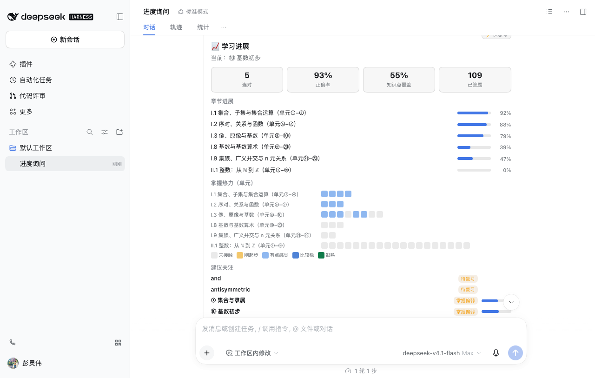
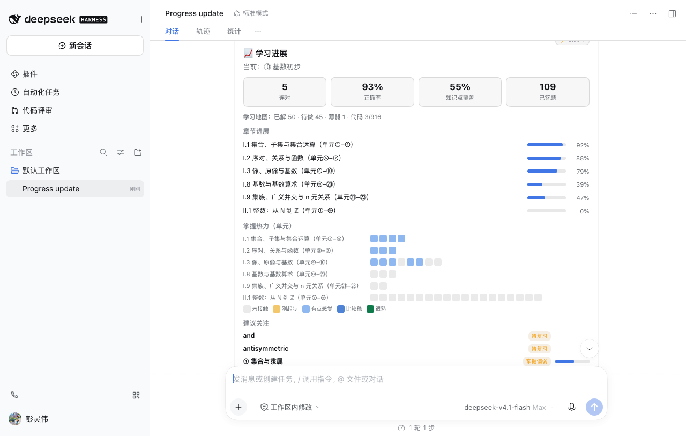

# C9.5 调度、复盘与学习地图：Before / After 证据

## 结论

| 场景（同一 1280×813 视口、浅色主题、中文 UI） | Before（`main` @ `c1047866`） | After（本分支） |
|---|---|---|
| 已开启快思考 → 回「进度」 | 进展热点卡：摘要 + 章节进展 + 掌握热力 + 建议关注（**没有学习地图行**） | 同一张卡，摘要与章节进展之间多一行 **学习地图：已解 50 · 待做 45 · 薄弱 1 · 代码 3/916**（数字来自 `engine.py map`，与聊天里「学习地图」同一份快照） |
| `engine.py map --state <真实 state>` | 只有单元符号（`I.1 ◐ ◐ ◐ ◐（0/4 单元稳）` …），没有知识点三态/代码题 | 每章多「已解/待做/薄弱/代码 n/m」，另有知识点覆盖行、薄弱知识点与代码题行 |





## 环境与流程

- **Before**：`git worktree` 从 `origin/main` @ `c1047866` 检出；**After**：本分支。
  两个隔离 DSH Web 实例（`DSH_HOME`、`SOKO_DSH_DATA` 各自独立；端口 3987 / 3988），
  同一版本 DSH（158.0.8127.38）、同一 1280×813 视口、默认浅色主题、中文。
- 两边都从**同一份 seeded 引擎状态**开始：真实状态（109 次作答、92.7% 正确率）派生，
  另加 3 道代码题 `mark-code`（`code_done` true）与 1 道 `skip-code`（`skipped`），
  所以 Before/After 比较的是同一个场景。（真实状态里没有代码题记录，为了展示
  C9.4 合并而补；“真实 state” 的原始运行另见下方 CLI 输出。）
- 走完全相同的脚本：`/sokonanoda-fast-think on` → `进度` → 截图。
- 截图是真实运行的 DSH Web UI（headless Chrome 经 CDP 操作 composer），不是 mock；
  状态来自真实课程引擎。

## 学习地图 CLI（同一份 seeded state）

Before（`c1047866`）：

```text
🗺️ 学习地图 · 共 39 个单元，稳了 0 个
I.1  ◐ ◐ ◐ ◐   （0/4 单元稳）
I.2  ◐ ◐ ◐   （0/3 单元稳）
I.3  ◐ ▶◐ ◐ · ◐ ◐ · ·   （0/8 单元稳）
I.8  · · ·   （0/3 单元稳）
I.9  · ·   （0/2 单元稳）
II.1  · · · · · · · · · · · · · · · · · · ·   （0/19 单元稳）

图例：✅ 稳　◐ 在学　◔ 刚起步　· 未碰　▶ 当前
你现在在：I.3 ⑩ 基数初步（本单元已答 15 题，接触 18/30 个知识点）
```

After（本分支）：

```text
🗺️ 学习地图 · 共 39 个单元，稳了 0 个
知识点：已解 50 · 待做 45 · 薄弱 1（共 195，96 个已有题）
I.1  ◐ ◐ ◐ ◐   （0/4 单元稳 · 已解 16 · 待做 0 · 薄弱 1 · 代码 3/115）
I.2  ◐ ◐ ◐   （0/3 单元稳 · 已解 20 · 待做 0 · 薄弱 0 · 代码 0/33）
I.3  ◐ ▶◐ ◐ · ◐ ◐ · ·   （0/8 单元稳 · 已解 13 · 待做 2 · 薄弱 0 · 代码 0/123）
I.8  · · ·   （0/3 单元稳 · 已解 0 · 待做 4 · 薄弱 0 · 代码 0/36）
I.9  · ·   （0/2 单元稳 · 已解 0 · 待做 4 · 薄弱 0 · 代码 0/30）
II.1  · · · · · · · · · · · · · · · · · · ·   （0/19 单元稳 · 已解 0 · 待做 34 · 薄弱 0）
薄弱知识点：kp.i1.subset 子集定义与展开（⊆ 是一条箭头）（正确率 33%，错 2）
代码题：已解 3 / 共 916（跳过 1）

图例：✅ 稳　◐ 在学　◔ 刚起步　· 未碰　▶ 当前
你现在在：I.3 ⑩ 基数初步（本单元已答 15 题，接触 18/30 个知识点）
```

## 复盘（After，真实 state）

```text
== 复盘（C9.5）==
作答 109 次 · 正确率 92.7%
每题耗时（只汇总，不作判据）：暂无记录
知识点：已解 50 · 待做 45 · 薄弱 1（覆盖 53% · 共 195，96 个已有题）
薄弱 tag（<阈值）：comp, antisymmetry, membership
薄弱知识点：kp.i1.subset 子集定义与展开（⊆ 是一条箭头）（正确率 33%，错 2）
错题 8 道：I.1.compl-1×1；I.1.mem-2×1；I.1.open-3×1；I.1.subset-1×1；I.1.subset-5×1；I.2.surj-1×1；I.3.equiv-algebra-4×1；I.3.preimage-2×1
代码题：已解 3 / 共 916（跳过 1）
内容缺口（无题 KP）99 个：kp.i10.class, kp.i10.class.algebra, kp.i10.class.eq, kp.i10.closure, kp.i10.closure.idem
下一批建议：I.1.compl-1(wrong), I.1.subset-1(wrong), I.1.subset-5(wrong), I.1.open-3(wrong), I.2.surj-1(wrong), I.3.equiv-algebra-4(wrong), I.3.preimage-2(wrong), I.1.subset-2(variant-of-wrong)
```

报告落 `courses/set-theory/knowledge/reports/`（已 gitignore）；报告 JSON 不含个人路径
（`review.py --selftest` 的 `review-no-personal-paths` 断言 `$HOME`/`/Users/` 不出现）。

## 指标（After）

同一份真实状态没有历史耗时字段，所以 `state.metrics.timing.timed = 0`；用两题显式
`--elapsed-ms`（4200 / 1800）跑一小段后：

```json
{"timed": 2, "untimed": 0, "totalMs": 6000, "avgMs": 3000, "medianMs": 3000, "maxMs": 4200}
```

`metrics` 同时给出 `accuracy`、`byLevel`、`byChapter`、`kp`（已解/待做/薄弱/覆盖/内容缺口）
与 `code`（已解/跳过/总数）。耗时只汇总展示，**不作通过/失败判据**。

## 限制（如实记录）

- Before/After 的会话标题由 DSH 自动生成（`进度查询` vs `Progress update`），
  与本次改动无关；卡片内容本身在同一状态、同一位置比较。
- `engine.py map` 的文本输出是**卡片模式的回退路径**（cards 不可用时的纯文本）；
  DSH 里默认走 progress 卡，两者读同一份 `map` 快照。
- 地图的「已解/薄弱」是**正确率**口径（结构计数），掌握度只用于热力图/排序；
  阈值在 `params.map.solved_accuracy_above`。
