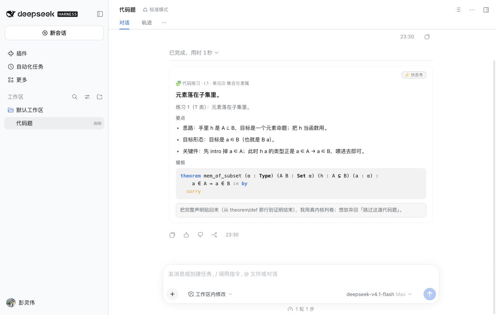
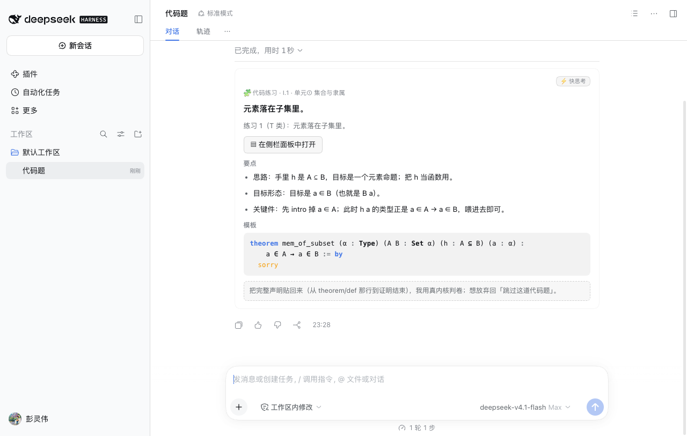
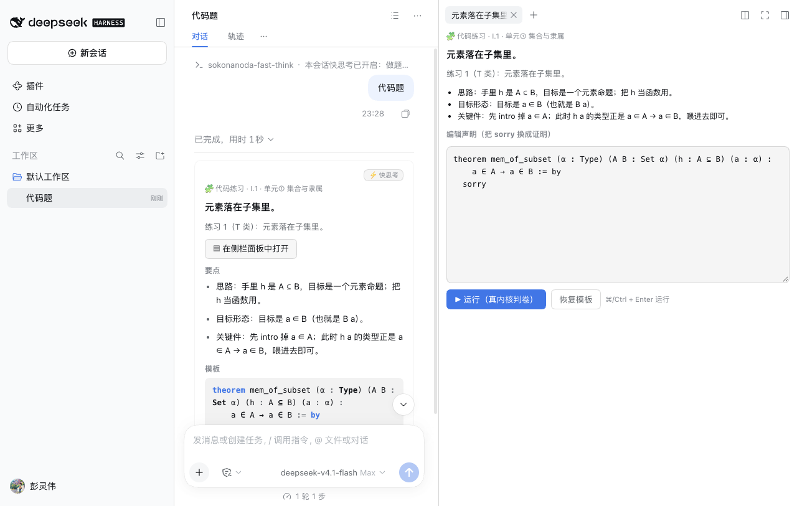
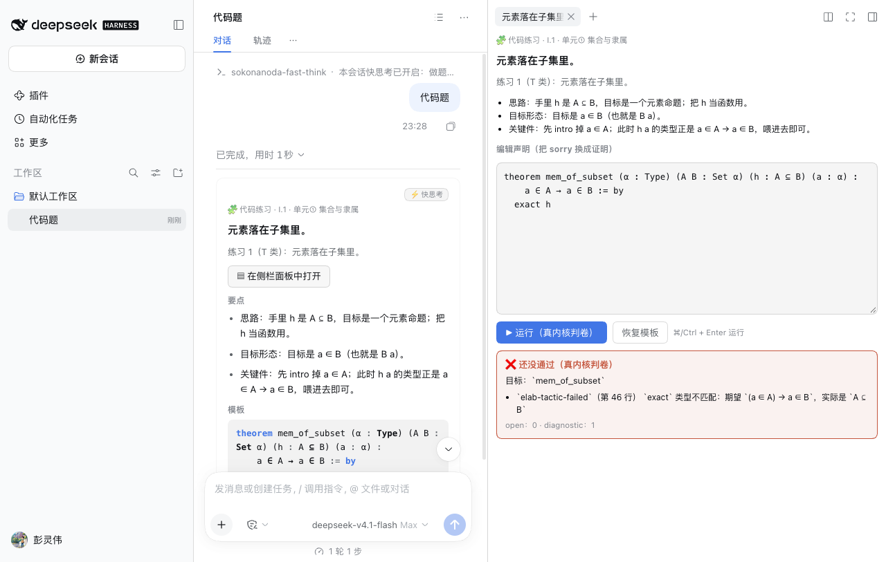
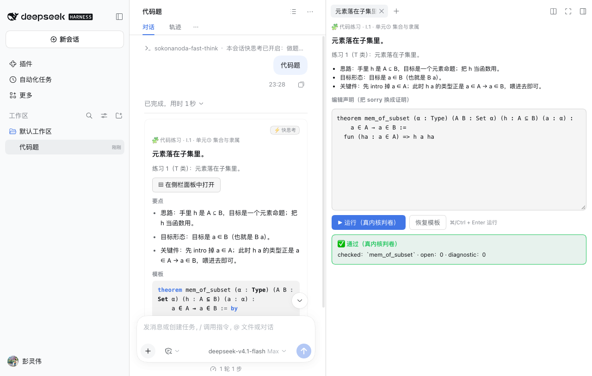

# C9.7 侧栏做题面板：Before / After 证据

## 结论

| 场景（同一 1280×813 视口、浅色主题、中文 UI、同一道代码练习） | Before（`origin/main` @ `75eff432`） | After（本分支 @ `b49c812f`） |
|---|---|---|
| 「代码题」发出的代码练习卡 | 题干 + 提示 + 带 `sorry` 的模板 + **聊天贴回**说明；没有任何面板入口 | 同一张卡 + **「在侧栏面板中打开」** 按钮；聊天贴回路径原样保留 |
| 点「在侧栏面板中打开」 | 无此入口（只有聊天快路径） | 右栏 `sokonanoda-exercise` 页：题目 + 提示 + **可编辑模板** +「运行（真内核判卷）」 |
| 编辑后运行 | — | 错误证明 → ❌ 目标 + `elab-tactic-failed`（第 46 行）+ 类型不匹配；正确证明 → ✅ `checked mem_of_subset · open 0 · diagnostic 0` |
| 判定来源 | 聊天快路径（C9.4，真内核） | 面板运行**复用同一条** `compose.py` + `scripts/soko grade --json`；没有假判卷、没有第二套路径 |

Before 的对照点就是「没有面板」：基线里同一张卡不存在面板入口，也没有可编辑区。
After 的卡片仍保留 C9.4 的聊天提交说明，所以无面板时（或不用面板时）聊天流程不回归。

## 环境与流程

- DSH **0.2.3-alpha.2**；两个隔离实例：Before `DSH_HOME=/tmp/panel-dsh-home-before`
  （端口 3988，插件来自 `origin/main` @ `75eff432`），After `DSH_HOME=/tmp/panel-dsh-home`
  （端口 3987，插件来自本分支）。两边 `SOKO_DSH_DATA` 各自独立，都从干净会话开始。
- 插件各自由自己的 worktree 用 `dsh plugin --profile web add <worktree>/dsh/plugins/sokonanoda-dsh`
  安装；同一模型配置（快路径命中时不会调用模型）。
- 同一个 headless Chrome（CDP 驱动真 DOM，非 mock），1280×813、`zh-CN`、浅色，
  脚本逐字发送同一条命令序列：
  1. `/sokonanoda-fast-think on`
  2. `代码题` → 截图 `before-code-card.png` / `after-code-card.png`
  3. After：点「在侧栏面板中打开」→ 截图 `after-panel.png`（题目 + 编辑器）
  4. After：把模板的 `sorry` 换成 `exact h` → 运行 → `after-panel-fail.png`
  5. After：换成课程解答 → 运行 → `after-panel-pass.png`
- 同一道题：`set-theory/I.1/unit01-sets-membership/mem_of_subset`（引擎从题目集发出的
  第一道具名代码题；两边 `code-next` 的 `issued_code` 相同）。

## 证据

### 1. 代码练习卡（同一道 `mem_of_subset`）

| Before | After |
|---|---|
|  |  |

Before 只有聊天提交说明（`把完整声明贴回来…`），没有面板入口；After 在同一位置增加
`▤ 在侧栏面板中打开`，其余题干/提示/模板/聊天说明不变。

### 2. After：侧栏面板（题目 + 编辑器 + 运行）



右栏 tab 标题取自题目（`元素落在子集里。`），正文是题目/提示、可编辑的模板、
`运行（真内核判卷）`、`恢复模板` 与 `⌘/Ctrl + Enter` 提示。

### 3. After：真内核判卷（错误 / 正确）

| 错误证明 | 正确证明 |
|---|---|
|  |  |

错误：`❌ 还没通过（真内核判卷）` + 目标 `mem_of_subset` +
`elab-tactic-failed`（第 46 行）`exact` 类型不匹配：期望 `(a ∈ A) → a ∈ B`，实际是
`A ⊆ B` + `open：0 · diagnostic：1`。
正确：`✅ 通过（真内核判卷）` + `checked：mem_of_subset · open：0 · diagnostic：0`。

## `--json` 证据（同一份提交、同一个判卷桥）

面板路由内部调用 `lib/code-grade.mjs` → `compose.py` + `scripts/soko grade --root
courses/set-theory --json`。用同一份题目/解答直接跑 CLI，结果与面板逐字对应：

```bash
# 错误提交（模板的 sorry 换成 exact h）
scripts/soko grade --root courses/set-theory /tmp/panel-wrong.sokonanoda --json
# exit 1；含：
# {"type":"diagnostic","stage":"elab","code":"elab-tactic-failed",
#  "message":"`exact` 类型不匹配：期望 `(a ∈ A) → a ∈ B`，实际是 `A ⊆ B`",
#  "span":{"start":{"line":46,...}}}
# 目标 mem_of_subset 没有 decl.checked、没有 exercise.open（声明失败 ⇒ diagnostic）

# 课程解答（compose.py --solution）
scripts/soko grade --root courses/set-theory /tmp/panel-pass.sokonanoda --json
# exit 0；含：
# {"type":"decl.checked","name":"mem_of_subset",...}
# 计数：decl.checked=1（目标）、exercise.open=0、diagnostic=0
```

面板截图中的目标、行号、诊断 code/message 与上面的 `--json` 事件一致；通过时同样
只报 `checked/open/diagnostic` 计数。

## 判据与测试

```bash
cd dsh/plugins/sokonanoda-dsh && node test/run.mjs   # host 33 + client 45
```

- Host 单测用**真内核**跑错误证明与课程解答两次判卷，并断言：
  - 题目只从仓库解析，`panelExerciseView()` 白名单**不含 solution**；
  - 路径穿越 ID → 400；未知 ID → 404；非 JSON → 415；错误方法 → 405；JSON 坏 → 400；
  - `apply()` 在 `webServer` 存在时注册两条 exact 路由。
- Client 单测断言：deep link 打开 `sokonanoda-exercise` 且带 `exerciseId`；面板预填
  模板、Run 可点；`pass` 只在 Host `result.passed === true` 时出现；diagnostic/sorry/
  服务失败都不显示通过；加载失败可重试。

## 限制（如实记录）

- **Before 没有任何面板**，所以它不是「旧面板」的样式基线；本对照证明的是入口从无到
  有、以及新面板的判定链。After 保留聊天提交说明，用于证明无面板路径不回归。
- 面板运行**不写课程进度**：`engine.py mark-code` 仍只在聊天提交路径调用（面板是做题
  面，不是第二套进度系统）。如果之后要记进度，应在 Host 判卷完成后接同一条 `mark-code`。
- 只编辑单条声明；多文件项目/书页/VS Code 编辑器不在本切片内；题目没有的 ID 返回
  `not-found`，不猜题目。
- 不改 kernel，也不改 C9.4 的判定口径。
- 两张卡片截图底部都有会话状态行 `深度求索中，用时 1 秒…`（DSH 的当前轮状态显示，
  两边同形），与面板无关。
