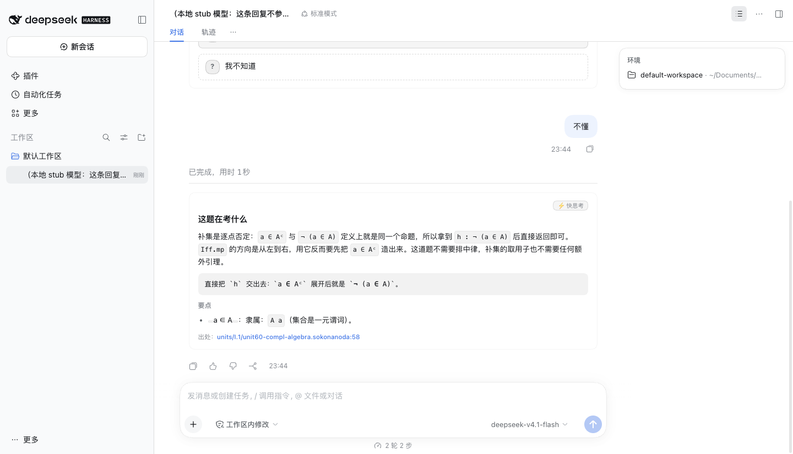
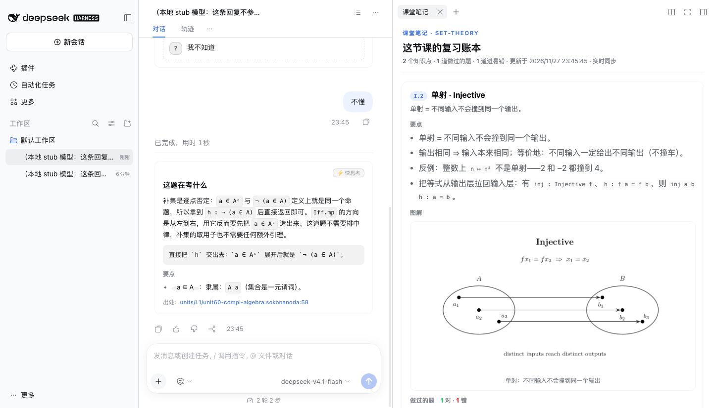
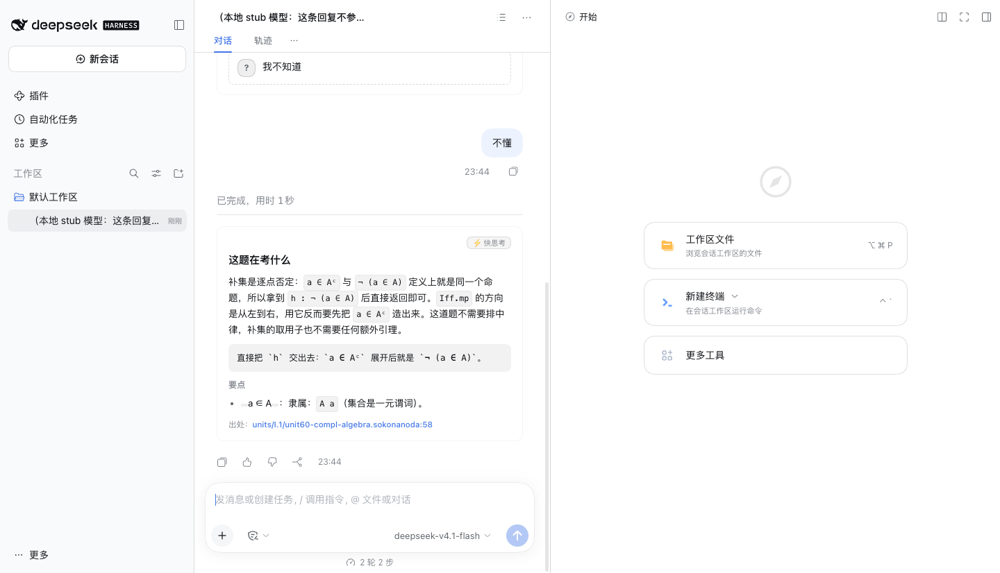
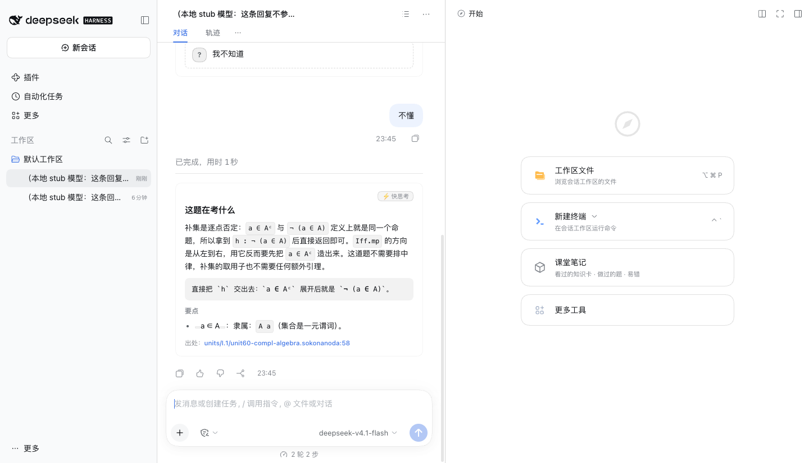
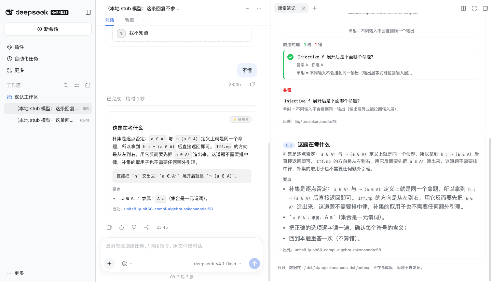

# 课堂笔记右侧栏闭环：Before / After 证据

## 结论

| 场景（同一 1440×826 视口、浅色、中文 UI） | Before（`origin/main` @ `29862401`） | After（本分支） |
|---|---|---|
| 做题中点「不懂」看知识卡 | 快路径返回知识卡；右栏不会出现笔记，只有原来的「环境」页 | 同一张知识卡落账后，右栏自动打开「课堂笔记」，显示知识点、图解，1.5s 内可继续自动刷新 |
| 右栏 guide 入口 | guide 只有「工作区文件 / 新建终端 / 更多工具」，没有「课堂笔记」 | guide 多一项「课堂笔记 · 看过的知识卡 · 做过的题 · 易错」 |
| 做过的题 | 没有笔记，谈不上题目/易错 | 「做过的题 1 对 · 1 错」；答对带 ✓，答错的同一题仍留在「易错」 |
| 图示 | 无 | `injective` 知识卡显示 TikZ 图解（`injective.png`），图片路由只服务白名单 PNG |

## 环境与流程

- **Before**：`git worktree` 从 `origin/main` @ `29862401`（当时无课堂笔记实现）检出，
  隔离 DSH profile 安装该 worktree 的插件。
- **After**：本分支的 `dsh/plugins/sokonanoda-dsh`，隔离 DSH profile，端口不同，
  两边各自独立的 `DSH_HOME` / `SOKO_DSH_DATA`。
- 同一版本 DSH Web（headless Chrome 经 CDP 操作 composer），同一 1440×826 视口、浅色主题、中文。
- 走同一脚本：新建会话 → `/sokonanoda-fast-think on` → 「开始做题」→「不懂」。
- After 额外把 quiz state 的 `issued_qid` 种到 `I.2.inj-1`（引擎题库里的单射题），
  这样 `/不懂` 返回的 `injective` 卡带有白名单图解；错/对记录来自引擎同一条
  `answer` 路径（隔离 profile 的临时状态，不入仓库）。
- 隔离 profile 的普通模型换成 **本地 stub**（`127.0.0.1:3999`）。命令回复会显示 stub 文案；
  题目与知识卡走插件快路径，不经过 stub 模型。

截图是**真实运行的 DSH Web**，不是 mock。

## Before / After

### 1. 点「不懂」之后

| Before | After |
|---|---|
|  |  |

Before：快路径知识卡正常，右栏仍是「环境」页，没有「课堂笔记」标签。
After：同一动作后右栏自动出现「课堂笔记」，账本头显示 `2 个知识点 · 1 道做过的题 · 1 道进易错`，
下面就是 `I.2 单射 · Injective`、要点与 TikZ 图解。

### 2. 右栏 guide 入口

| Before | After |
|---|---|
|  |  |

Before：guide 只有「工作区文件 / 新建终端 / 更多工具」。
After：新增「课堂笔记 · 看过的知识卡 · 做过的题 · 易错」。

### 3. 题目 ✓ / × 与「易错」

- `做过的题 1 对 · 1 错`；
- 最新一次答对的 `I.2.inj-1` 显示 ✅、`答案 A · 你选 A` 与解析；
- 同一题早先的错答仍留在「易错」——复习账本记录发生过什么，不是只记最后一次分数；
- 下方是点「不懂」时引擎真实返回的 fallback 知识卡对应的笔记（`这题在考什么`）。

## 限制（如实记录）

- 本证据只覆盖浅色主题；暗色由同一套 `--cn-*` 变量与父窗口 token 镜像覆盖，未另截一张。
- 图解目前只有显式白名单（`injective`、`set-ext` 两张）；没有图的卡片不硬塞图。
- 笔记的题目归属是 **标签启发式**（与 `engine.py explain_for` 同规则：≥2 个共享标签，
  或至少 1 个非通用标签），匹配不到就不进笔记。
- After 的「自动出现」是**每页加载一次**：首次看到新笔记时自动开 tab；用户手动关掉后，
  本页不再抢焦点，下次刷新页再判断。
- Before 的「更多工具」是基线自带的；After 的 exercise-panel（C9.7）已合入
  `origin/main`，本证据的 Before 基线包含它，但本场景没有触发代码题面板。
