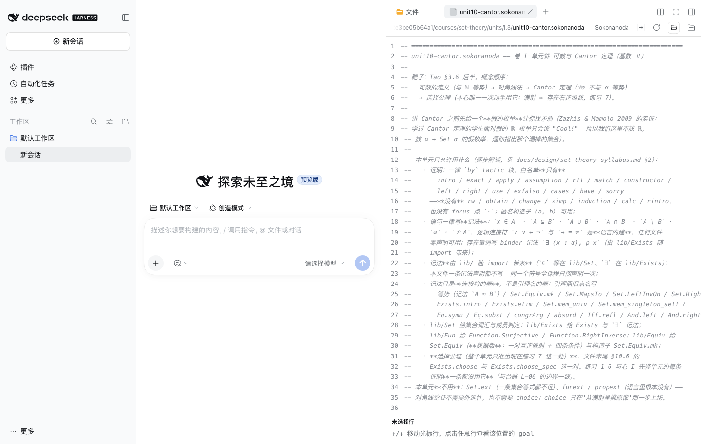
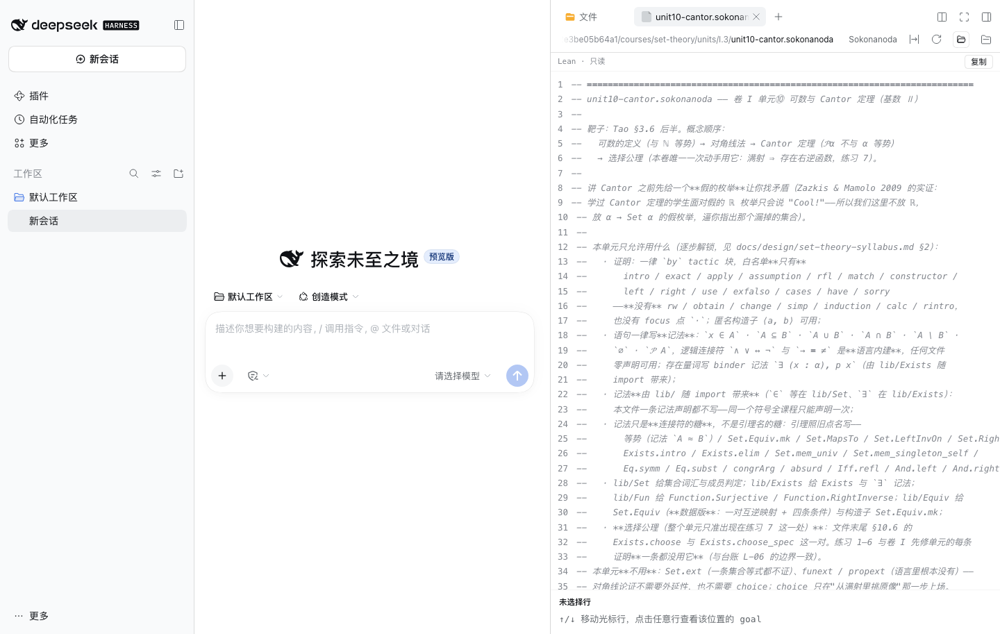
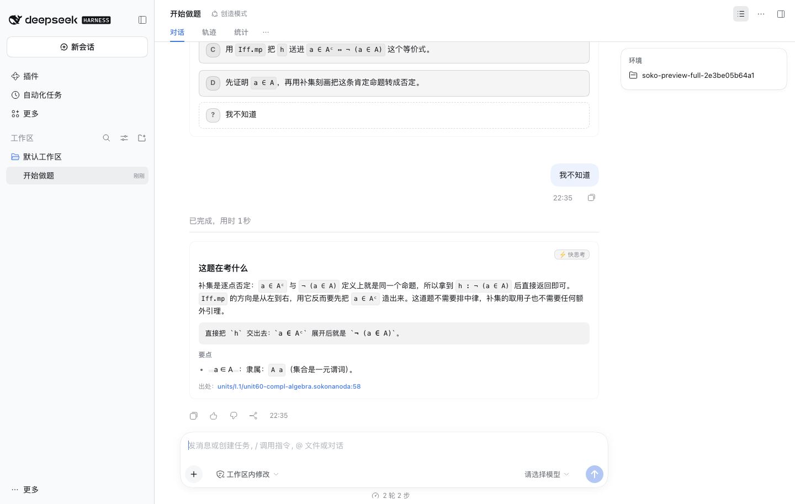
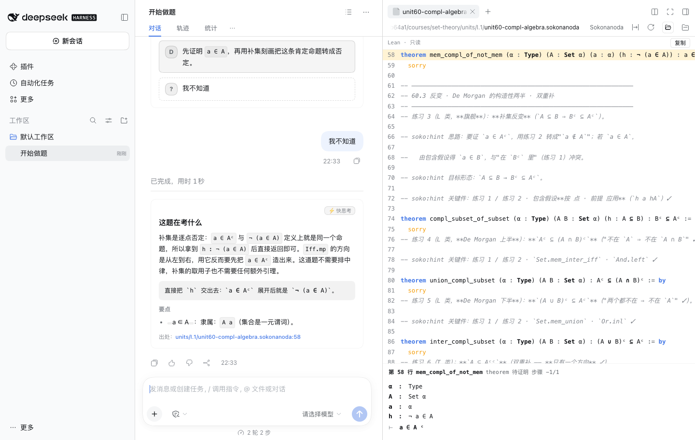
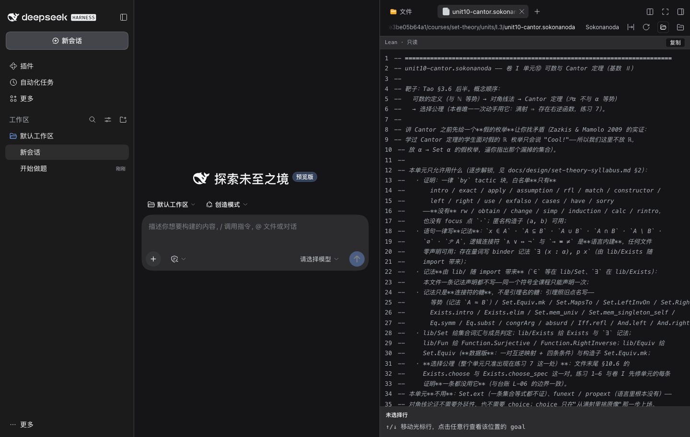

# #116 `.sokonanoda` 代码预览：Before / After 证据

## 结论

| 场景 | Before（`origin/main` @ `fcf6f72f`） | After（本分支） |
|---|---|---|
| 打开 `unit10-cantor.sokonanoda` | 有行号与高亮，但每行没有 `data-textpreview-line`（owner 的 `scrollToLine` 命中 0 行）；没有复制按钮 | 207 行全部挂 `data-textpreview-line`；工具栏「Lean · 只读」+「复制」；行号仍为 1–207，滚到底再回顶不漂移 |
| 点知识卡「出处」定位第 58 行 | client-report 记录 `sidebar-right: missing`；点击后右栏没有文件标签（`sources: 0`、`textpreview-state: []`、`tab: false`） | 打开会话内文件地址；第 58 行有 `data-textpreview-target`/活动行、`targetVisible: true`、`scrollTop: 1219`；goal 面板显示 `mem_compl_of_not_mem / theorem / 待证明 / 步骤 1/-1` |
| 暗色主题 | —（同一实现） | 行号、高亮、工具栏与复制按钮使用 `--dsw-alias-*` token，暗色正常 |

截图是真实运行的 DSH Web（headless Chrome 经 CDP 操作；隔离的 `DSH_HOME` 与
`SOKO_DSH_DATA`，同一 1440×913 视口、同一仓库工作区），不是 mock。逐项 DOM 读数见
`dom.json`。

## Before / After

### 1. 直接打开文件

| Before | After |
|---|---|
|  |  |

Before：207 行、行号 1–207、高亮 371 个 token；`[data-textpreview-line]` = 0、无复制按钮。
After：同样 207 行/1–207/371 token；`[data-textpreview-line]` = 207、复制按钮出现。

### 2. 点「出处」跳到第 58 行

| Before | After |
|---|---|
|  |  |

Before：知识卡底部有 `出处：units/I.1/unit60-compl-algebra.sokonanoda:58`，点击后
右栏仍是环境面板，没有打开文件（链接落到 `absolute` 备选地址，且 `sidebarRight`
服务在插件 apply 时缺失、之后也没补注入）。
After：同一张卡、同一条链接打开 `.sokonanoda`，滚到第 58 行并闪一下；行号是文件
真实行号（58–88 可见），goal 面板同时显示该行状态。

### 3. 暗色主题

## 限制

- Before 的「点出处」在隔离 profile 里是**死链**（首页 `sidebar-right: missing`）；
  真实 profile 里若 Sidebar 服务已就绪，旧实现仍会走 `content.text` 切片且行元素没有
  `data-textpreview-line`，owner 无法定位到目标行。
- `unit10-cantor.sokonanoda` 只有一页，所以这张截图里“滚到底加载下一页”没有触发；
  多页 offset/懒加载由 `client.smoke.cjs` 的多页用例与 owner 的既有分页逻辑覆盖。
