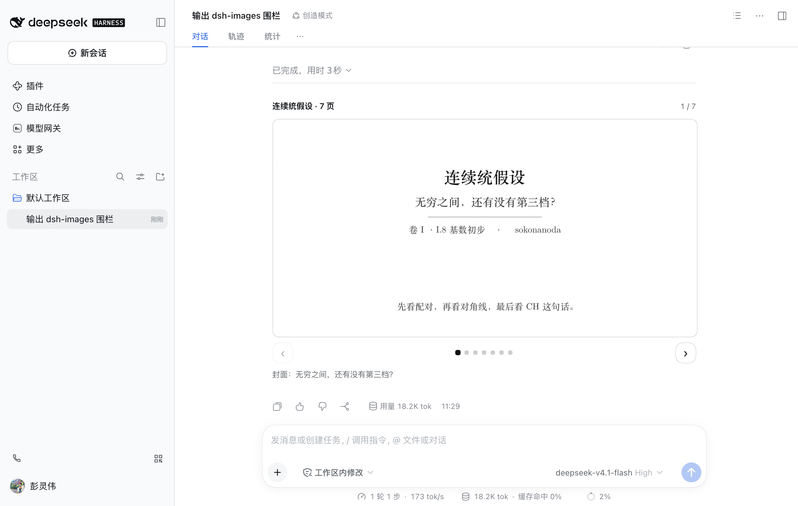
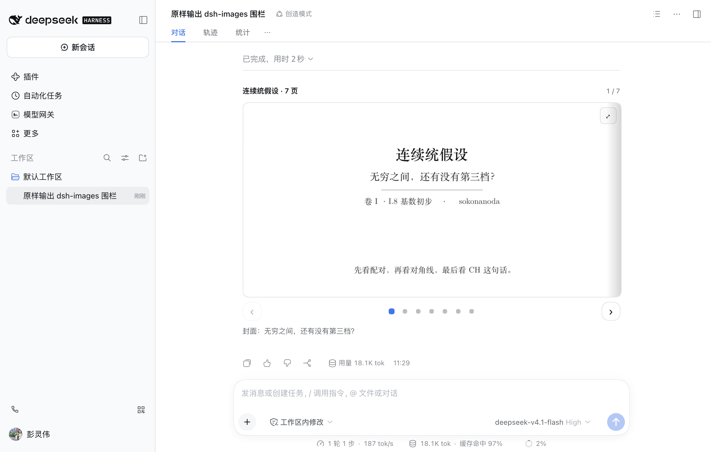
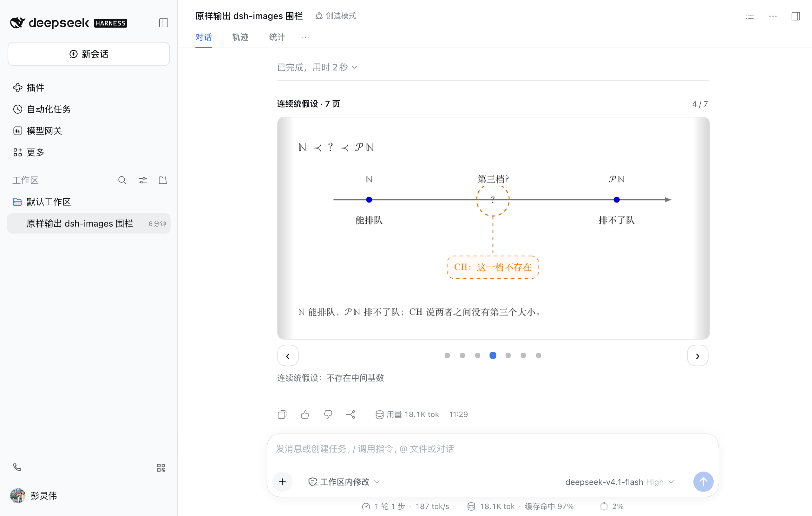
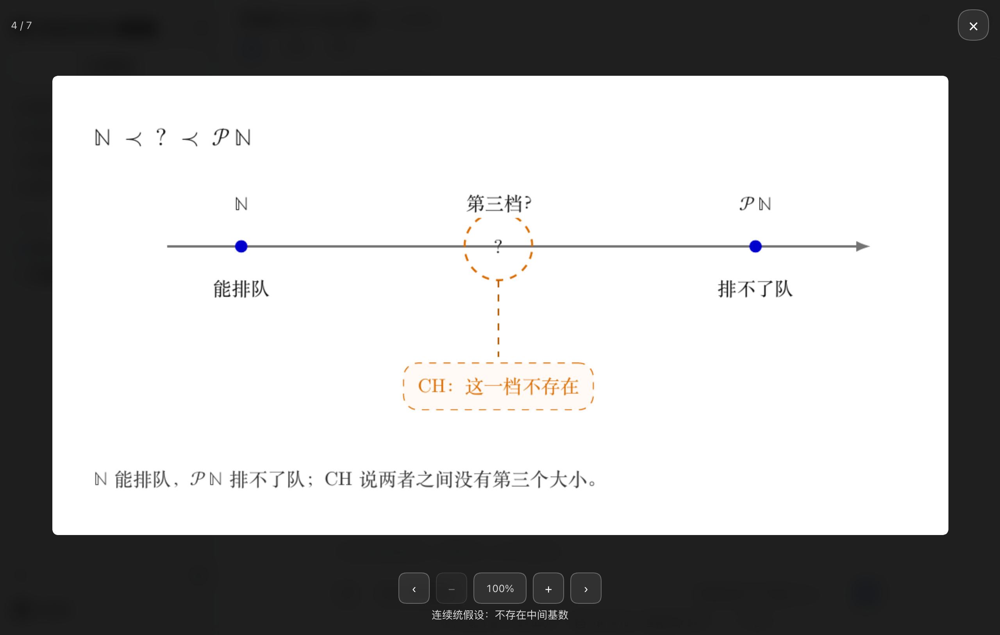
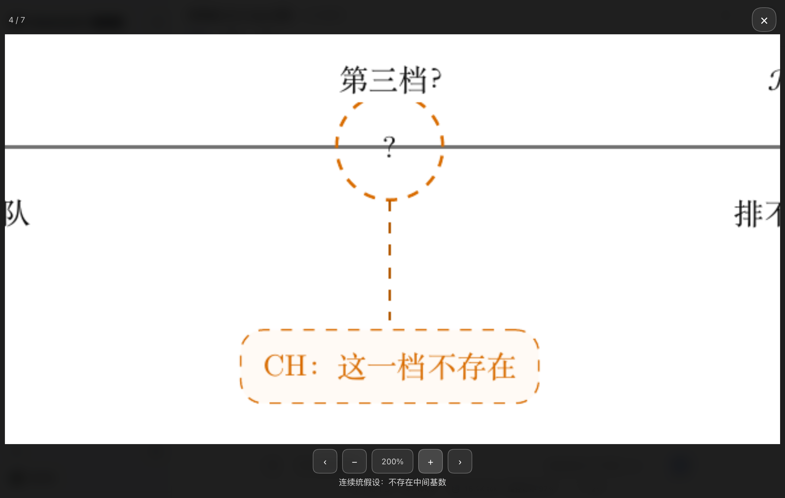
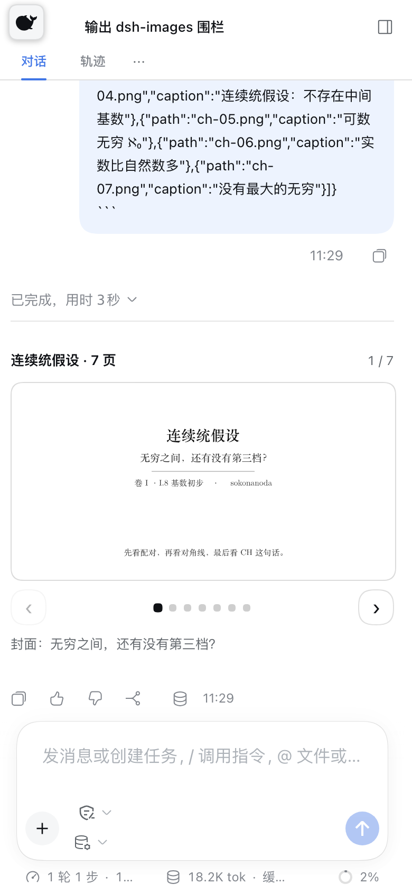
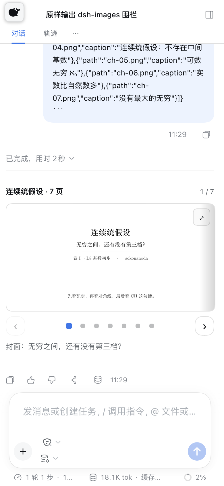
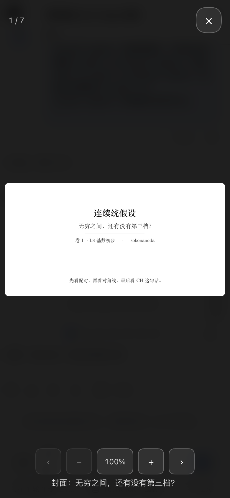
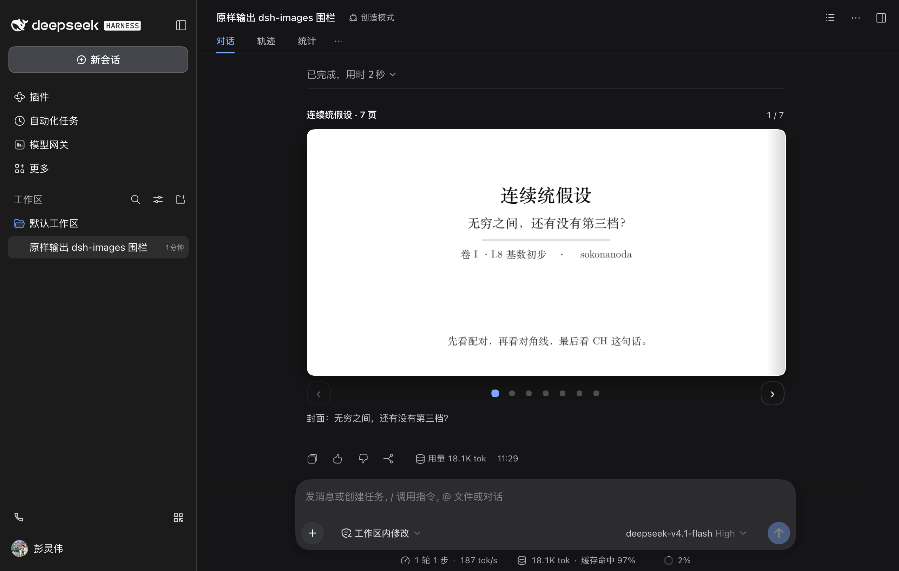
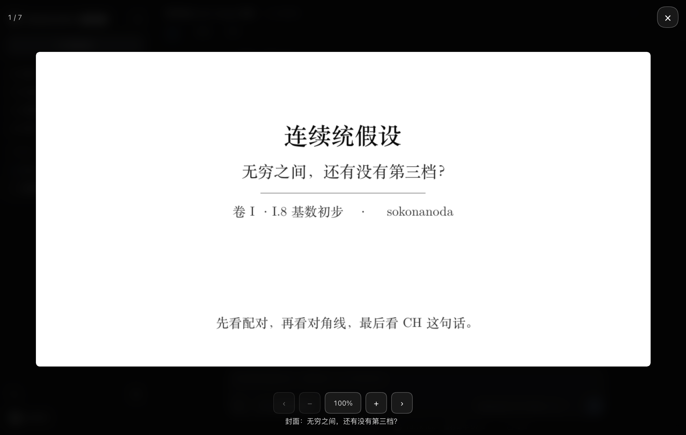

# dsh-images 画册优化：Before / After 证据

## 结论

| 场景（同一 1280×813 视口、浅色主题、中文 UI、同一 7 页 JSON 与同一批
`ch-01..ch-07.png`） | Before（v1 @ `35db48c6`，`plw/solution` @ `ff781bd1`） | After（本分支 @ `e8800da1`） |
|---|---|---|
| 首屏画册 | 7 页可滑动、圆点/页码/图注、无放大入口、圆点仅 7px | 同一 7 页 + 右上 `⤢` + 蓝色当前点 + 两侧边缘渐变提示；圆点命中区 ≥24px |
| 点页 / `⤢` | 无 | 全屏 lightbox：页码、关闭、`‹ ›`、`− 100% +`、图注 |
| 缩放 / 平移 | 无 | 滚轮 150%、双指/滚轮至 400%、拖拽平移、双击 250%、`Esc` 关闭 |
| 键盘 | `←` / `→` | `←` / `→` / `Home` / `End` / `PageUp` / `PageDown`；lightbox 内同键翻页 + `+`/`-`/`0` |
| 预加载 | 只有首屏 eager，其余 lazy | 首屏仍只 eager 第一页；当前页 ±1 用 `Image()` 预取（单测钉住） |
| 失败 | 保留路径与提示 | 保留路径 + 「重试」（`&retry=N` 绕缓存） |
| 移动端 390×844 | 内容可用，但无 `⤢`、无 safe-area、圆点 7px | 触控可见 `⤢`、44px 翻页键、24px 圆点、底部 safe-area、边缘渐变 |
| 深色 | 固定浅色 token | 白底 + 深色下可见描边/阴影、图注 token 对比、lightbox 深色遮罩 |
| 无障碍 | 无 aria-live | polite 播报「第 N 页，共 7 页：图注」；进入 lightbox 焦点到关闭按钮，`Esc` 后回到画册 stage |
| 图片路由 | `auth: 'anonymous'`（README 却写 owner-authenticated） | `auth: 'required'`：登录后 200 / 匿名 401（`auth.txt`） |

Before 的对照点就是「v1 画册」：它仍然能翻页、图注跟随、坏 JSON 显式报错；
After 保留这些行为，新增的是交互与移动端/深色/无障碍细节，而不是重做画册。

## 环境与流程

- DeepSeek Harness `0.2.3-alpha.2`；两个**隔离实例**：
  Before `DSH_HOME=/tmp/dshimg-evidence/before`（端口 3988，插件来自 v1 代码），
  After `DSH_HOME=/tmp/dshimg-evidence/after`（端口 3987，插件 symlink 到本分支）。
  两边复制同一份 `web` profile、同一模型配置（本地 relay 上的
  `deepseek-v4.1-flash`，High）、同一批会话/主题设置，互不影响真机 profile。
- 同一个 headless Chrome（CDP 驱动真 DOM，非 mock），1280×813 / 390×844、
  `zh-CN`；两边都向模型发送**同一条指令**：只输出同一个 7 页 `dsh-images` 围栏
  （JSON 逐字相同），等待助手消息里的画册渲染完成后再截图。
- 截图文件均为真 DSH Web 应用捕获；没有用设计稿冒充 Before/After。

## 证据

### 1. 桌面浅色：同一画册的首屏

| Before | After |
|---|---|
|  |  |

After 在右上多出 `⤢`，当前圆点改为品牌蓝，右侧出现「还有下一页」的边缘渐变；
页码、图注、页面高度与 7 页内容完全一致。

### 2. 翻到第 4 页（After）



页码 `4 / 7`、图注跟随、左右两侧都出现边缘提示；Before 的同一动作只有页码与
圆点变化（无 `⤢`、无边缘提示）。

### 3. 全屏 lightbox（After）

| 100% | 200% |
|---|---|
|  |  |

`Esc` 关闭、`←`/`→` 翻页、`+`/`-`/`0` 缩放；滚轮、拖拽、双击的实测读数见
`verify.txt`（wheel 150%、pan `translate(120px, 40px) scale(1.5)`、双击回 100%）。

### 4. 移动端 390×844：Before / After

| Before | After | After lightbox |
|---|---|---|
|  |  |  |

After 的 `⤢` 在触控设备常显、圆点命中区 24px、翻页键 44px、底部安全区、
lightbox 控件贴合安全区；Before 只有 7px 圆点和 34px 翻页键。

### 5. 深色模式（After）

| 画册 | lightbox |
|---|---|
|  |  |

白底图与深色卡片用 `border-l3` + 阴影分隔，图注用 `label-secondary`，
lightbox 用 `bg-mask-photo` + blur；没有固定浅色写死。

### 6. 真应用交互读数

`verify.txt`（同一 After 实例）记录了：

- `End` → `7 / 7`，`PageDown` → `2 / 7`；
- aria-live 文本 `第 7 页，共 7 页：没有最大的无穷`；
- 第 7 页左侧边缘 `data-visible=true`；
- 打开 lightbox 后焦点在「关闭（Esc）」按钮，`Esc` 后焦点回到 `dii-deck-stage`，
  `.dii-lb` 数量 0；
- 可见页会触发相邻页图片请求（导航到 End 时 lazy 页也会因滚动加载，单测另行
  钉住「只预取 ±1」）。

## 自动化判据

```bash
cd dsh/plugins/dsh-inline-image
node --check client.js && node --check index.js
node test/run.mjs
```

- host 9：7 页样例逐页 200/PNG/owner-private、`&retry` 仍 200、HEAD、405、
  越界 404、非图 415、超限 413、health 的 `clientAgeMs`、两条路由 `auth=required`。
- client 16：7 页/圆点/页码/图注/aria-live、首屏 eager、键盘翻页、±1 预取、
  失败重试、lightbox 缩放/翻页/焦点恢复、HMR 刷新提示、坏 JSON/流式透传、
  单图重试。
- CI：`.github/workflows/ci.yml` 新增 `dsh-inline-image-tests`，不设过滤条件，
  每次 push/PR 都跑这条命令。

## 已知限制

- **教学流程打通未做**：讲解图自动分页、图注生成、与 `sokonanoda-teacher`
  快路径联动需要内容流水线与产品设计，不是这个画册组件的局部改动；本笔只
  交付画册交互/预加载/移动端/无障碍/深色/重试/HMR 提示，issue #136 保持打开。
- **HMR 提示只做了单测 + health 契约**：真机上「改 `client.js`」会让 HMR
  成功重载（提示不会出现）；只有 HMR 失败、页面仍跑旧 bundle 时提示才出现。
  这个失败态不容易在真机稳定制造，所以用 host 的 `clientAgeMs` + client 的
  持续时间比较单测钉住逻辑。
- **双指捏合**：Playwright 不能注入真实双指；滚轮缩放、拖拽平移、双击缩放
  已在真应用验证，捏合的指针数学（`pointerDistance`/`clampPan`）在单测里钉住。
- **Before 没有 lightbox 状态**：v1 没有放大/重试/键位/深色适配，所以这些
  只有 After 截图；Before 的对照是同一画册的首屏与移动端。
