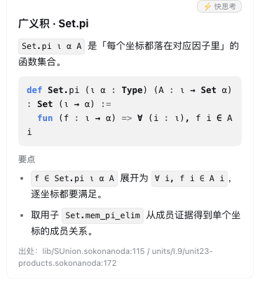
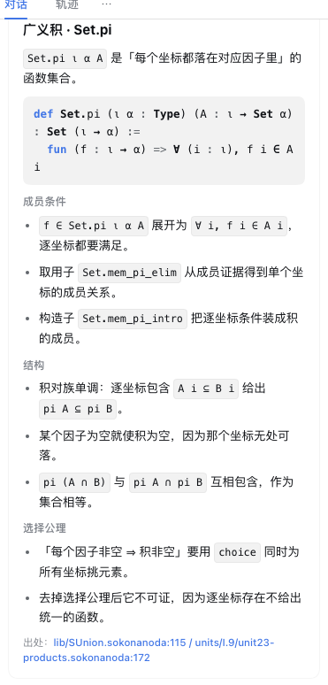
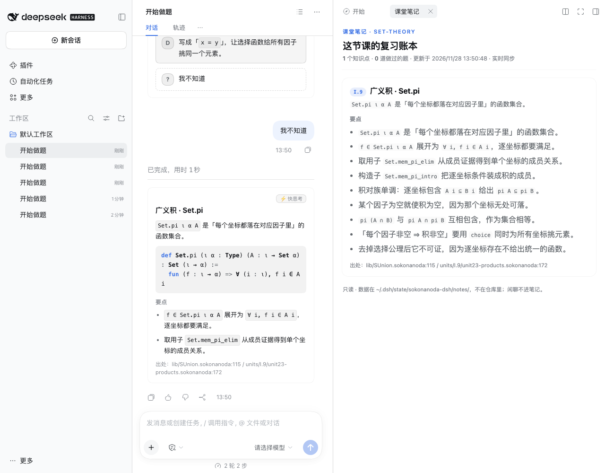
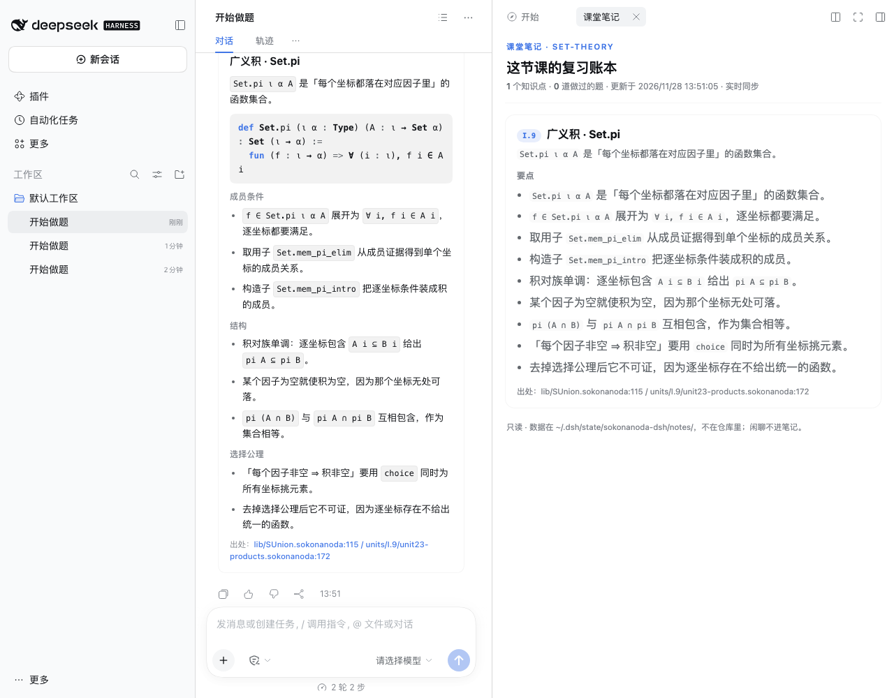
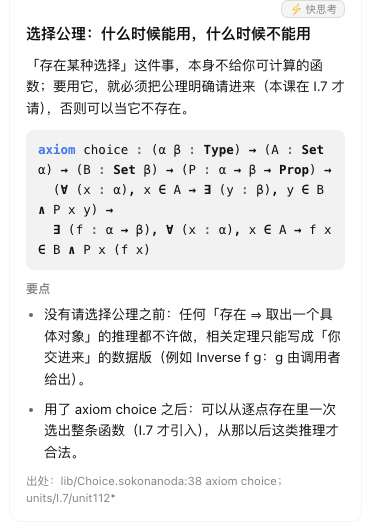
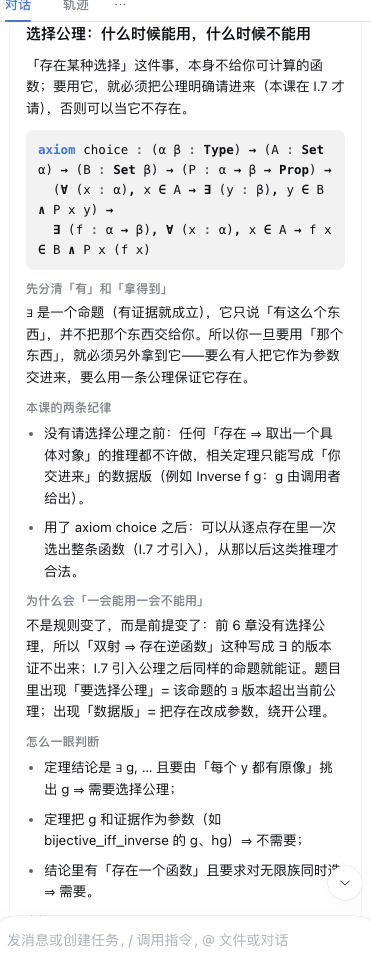
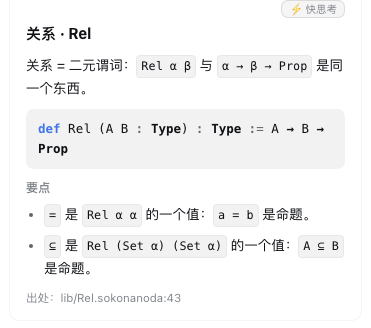
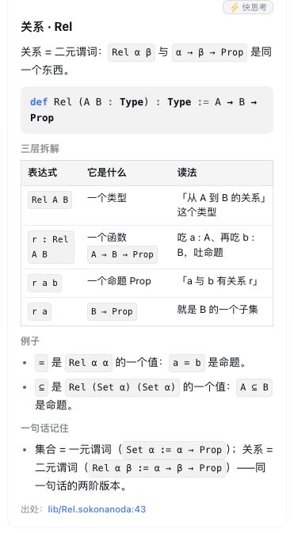
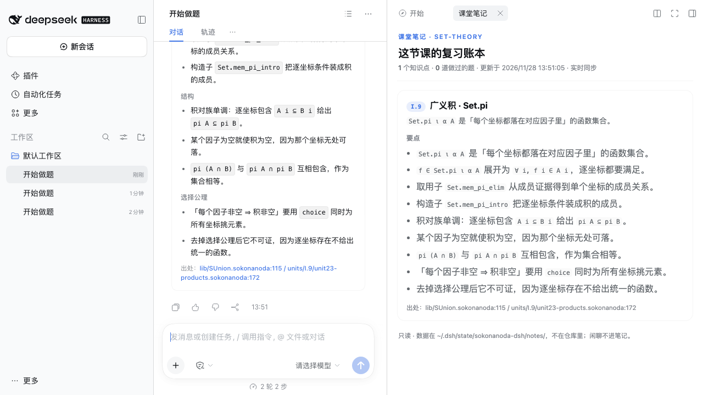

# 知识卡 sections 完整渲染：Before / After 证据（#139）

## 结论

| 场景（同一 1280 px 视口、浅色主题、中文 UI、同一 `quiz/default.json` 种子、
同一点「我不知道」动作） | Before（`956e4fb0`，`pointsFromSections` + `slice(0, 2)`） | After（本分支修复提交） |
|---|---|---|
| 真卡 `I.9.product-ac-1` → `Set.pi` 知识卡 | 1 个「要点」标题、2 条 item；`成员条件`/`结构`/`选择公理` 三段与 `choice` 读法全丢 | 3 个段标题、8 条 item；`选择公理` 段与 `choice` 读法按引擎顺序出现 |
| 真卡 `I.3.axiom-choice-1` → `choice-axiom` 知识卡 | 只有「要点」2 条 item；两个 `paragraph` 段整段丢失 | 4 个段标题（含两个 `paragraph` 段）、5 条 item |
| 真卡 `I.2.rel-1` → `Rel` 知识卡 | 表格段 `三层拆解` 整段丢失，只剩「要点」2 条 | 3 个段标题；表格（表头 3 列 + 4 行）与两个 list 段全部渲染 |
| 长卡片（`Set.pi` 卡，card 高 730 px > 可见 720 px） | 卡只有 362 px，无滚动需求 | 卡片在聊天滚动容器内可滚（`scrollHeight 1854 > clientHeight 644`），滚到底能看到 `选择公理` 段 + 出处 |

三张真卡都来自仓库当前题库（`courses/set-theory/knowledge/data`）的 engine `explain`
输出；两边的卡片 payload 逐字节相同，只换渲染代码。

## 环境与流程

- DeepSeek Harness `0.2.3-alpha.2`；两个**隔离实例**（互不影响真机 profile）：
  - Before：`DSH_HOME=/tmp/kcf/before-home`，端口 3961，插件来自 `956e4fb0`
    的 `client.js` / `quiz-proxy.mjs`；
  - After：`DSH_HOME=/tmp/kcf/after-home`，端口 3962，插件 symlink 到本分支工作区。
  - 两边同一份 `web` profile、同一 `SOKO_DSH_DATA` 空目录、同一份
    `courses/set-theory` 题库与 engine、同一 1280×1000（长卡片另用 720 高）视口。
- 同一个 headless Chrome 158（CDP 驱动真 DOM，非 mock），`zh-CN`、浅色；
  流程逐字相同：新建会话 → `/sokonanoda-fast-think on` → 「开始做题」→
  等出题卡 → 把 `quiz/default.json` 的 `issued_qid` 置为目标题（两边同值）→
  点卡片上的「我不知道」→ 等知识卡渲染 → 截图。
- 截图均为**真 DSH Web 应用捕获**；没有用设计稿或静态 HTML 冒充 Before/After。
- 自动化读数在 `*-verify.json`：段标题列表、每个 list 的 item 列表、table 的
  表头/行、`definition` 与 `source` 文本、card 几何、长卡片滚动容器读数。

## 证据

### 1. 复现原题：`I.9.product-ac-1` 的 `Set.pi` 知识卡

| Before（2 条 + 丢段） | After（3 段 8 条 + `choice`） |
|---|---|
|  |  |

Before 只渲染第一个 list 段的前 2 条（`成员条件` 前两条），`结构`、`选择公理` 段
与 `choice` 的关键读法全部丢失；After 按 `sections` 顺序渲染全部段，标题、一句话、
`definition.code`、出处位置不变。

真应用上下文（同一动作、同一视口；右侧为课堂笔记，不参与本卡渲染）：

| Before | After |
|---|---|
|  |  |

### 2. `paragraph` 段：`I.3.axiom-choice-1` 的 `choice-axiom` 知识卡

| Before（2 条，两个 paragraph 段丢失） | After（4 段，含两个 paragraph 段） |
|---|---|
|  |  |

`先分清「有」和「拿得到」`、`为什么会「一会能用一会不能用」` 两个 `paragraph`
段在 Before 整段不见；After 段落文本（含 inline code）按引擎顺序渲染。

### 3. `table` 段：`I.2.rel-1` 的 `Rel` 知识卡

| Before（表格段丢失） | After（表头 3 列 + 4 行） |
|---|---|
|  |  |

表格按课程海报渲染器的同形数据（`columns`/`rows`）渲染，单元格内 inline code
继续走 `inlineNodes`。

### 4. 长卡片：滚动而不是静默截断

After 的 `Set.pi` 卡高 730 px，可见聊天区 644 px：`scrollableAncestor: true`，
`scrollHeight 1854 > clientHeight 644`；滚到底的截图：



## 自动化判据

```bash
cd dsh/plugins/sokonanoda-dsh && node test/run.mjs
```

- host 41 / client 47 全绿。新增 / 更新的判据：
  - client：`knowledge fence renders every section in order (no truncation)` ——
    `list` 全部 items、`paragraph` 的 `text`、`table` 的 `columns`/`rows`、
    段顺序、inline code、table CSS；
  - client：原 `knowledge fence renders title, definition tokens and source`
    增加「第三条 points 也渲染」断言（旧 `slice(0, 2)` 会红）；
  - host：`legacy text knowledge card renders every section and item (cards=false path)`
    —— 纯文本快路径同步去掉 sections/items 截断，表格输出 GFM 表。

## 已知限制

- 这里的 Before/After 用同一份种子状态把 `issued_qid` 定向到目标题；截图只截
  知识卡区域，所以出题卡与知识卡的对应关系不影响对照，但这不是一次“随机抽题
  恰好抽到”的自然回放（三张卡的 payload 本身是 engine 原样输出）。
- 滚动证据只证明聊天容器可滚、内容可达；截图无法表达“滚动手势”，滚动读数在
  `*-verify.json` 的 `longCard` 字段。
