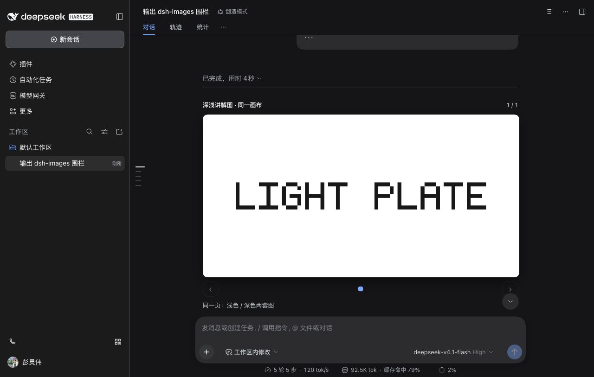
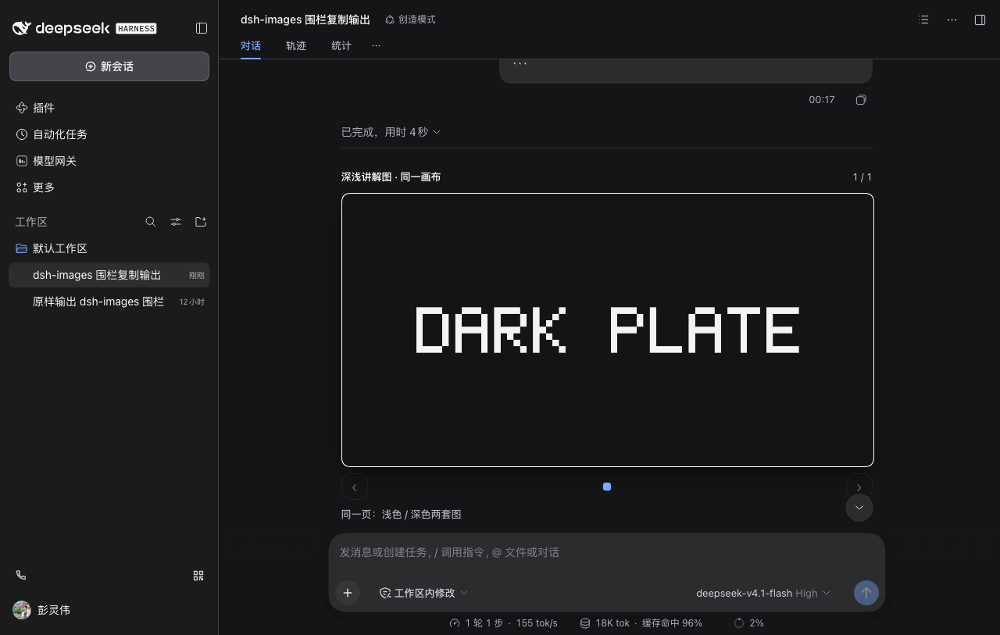
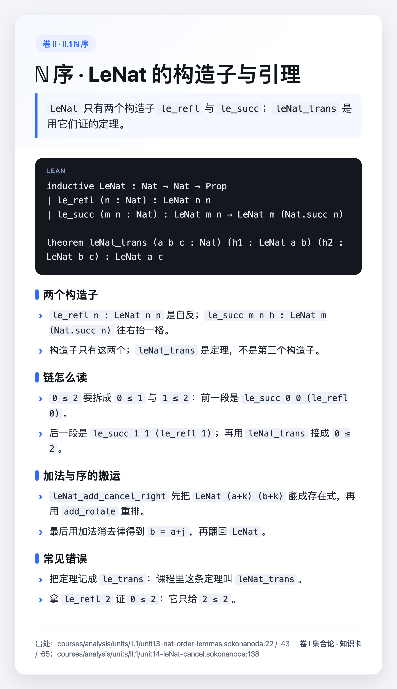
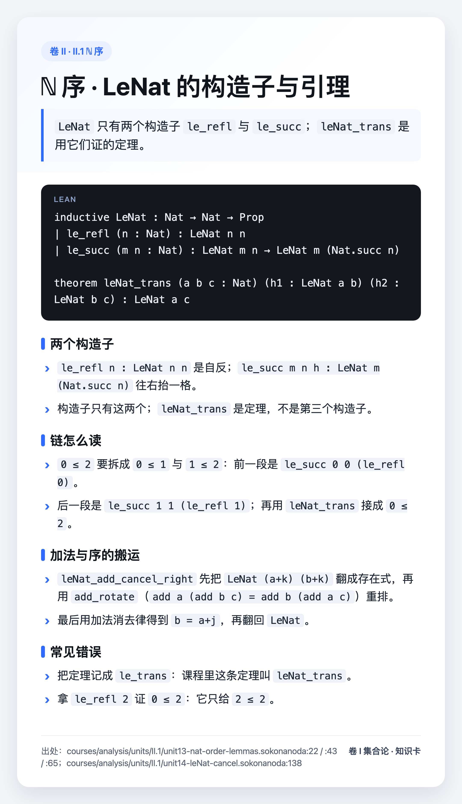

# 做题内容质量可执行门禁（总任务 #147）Before / After 证据

日期：2026-11-28/29。本目录是 PR 的证据与读数存档（生成物，不是判据）。
子 issue：#149（题目表达）/ #150（卡片内容）/ #151（会话预检）/ #152（讲解图深色）/
#153（存量清账）；#146（卡片覆盖）由 PR #148 交付，#142/#144 已先收口。

## 判据（一条命令）

```bash
python3 courses/set-theory/knowledge/text_lint.py            # 0 errors；warnings 基线只减不增
python3 scripts/card-lint.py                                 # 0 处违例（覆盖 + 内容）
python3 scripts/lesson-preflight.py --all                    # content 模式 0 blocker
python3 scripts/lesson-preflight.py --limit 22 --json        # learner path 0 blocker
python3 scripts/lesson-preflight.py --selftest               # 红/绿 fixtures（17 条）
cd dsh/plugins/dsh-inline-image && node test/run.mjs         # host 9 / client 24 全 PASS
```

## Before / After 读数（同一棵树、同一套判据）

| 判据 | Before（main @ 95d3cd3e） | After（本 PR） | 证据 |
|---|---|---|---|
| text-lint errors（X11 自造术语） | 23 处（落点 15 / 全称命题 5 / 原序对 3，18 题） | **0** | `text_lint.py` |
| text-lint warnings | 107（X5-long 81 / X5-splice 26） | **173**（X5-long 81 / X12 29 / X13 63；X5-splice **0**） | 基线收紧 |
| X5-splice（逗号粘连） | 26（learner path 3） | **0** | `text_lint.py --json-out` |
| card-lint 违例（覆盖） | 67（#146 前；#146 清到 0） | **0** | `card-lint.py` |
| card-lint 内容违例（新规则） | 1（`II.1.lecancel-2` 的 `add_rotate` 裸挂） | **0**（`nat-order-lemmas` 补结论） | 卡片截图 |
| learner path preflight（I.8/I.9 未作 22 题） | 无预检（坏题会直接发） | **0 blocker / 18 warnings** | `preflight-learner-22.json` |
| content preflight（409 题） | 无预检 | **0 blocker / 92 warnings**（基线 0 条） | `preflight-all.json` |
| dsh-images darkPath | 不存在（深色仍显示浅色图） | 深色自动换深色图（5 态 + 实时切换） | `s7-before/after.png` |

## 反例验证（守卫真的会拦）

- text-lint：自造术语 option ⇒ `exit 1`；隐喻 option ⇒ X12 warn；超长中文 option ⇒ X13 warn；
  干净 JSON ⇒ 0/0。fixtures 见 `text-lint-fixtures.json`（38 条对照）。
- card-lint：只报名字不给结论 ⇒ content 违例（fixtures）；旧 `cards.json` ⇒ 67 覆盖违例。
- lesson-preflight：X11 / 选项引理无卡 / fallback 缺 why 三种坏内容全判红；
  fixtures 17 条对照；历史坏输入（`95d3cd3e` 的 questions.json）⇒ `--all --no-baseline` exit 1。
- darkPath：关掉特性后 7 条新用例全红、旧 17 条全绿。

## Before / After 截图

### S7 · 讲解图深色（真 DSH Web，1280×813，深色主题，同一画布 JSON）

同一画册同一页；Before 插件来自 `origin/main`（无 darkPath），After 为本改动：

| Before（白板，center pixel [255,255,255]） | After（深板，center pixel [20,20,20]） |
|---|---|
|  |  |

机器读数：`s7-before.json` / `s7-after.json`（imgSrc、中心像素、`body[data-ds-dark-theme]`、
natural 1147×588）；复现说明见 `s7-README-evidence.md`。

### S5 · 知识卡内容（同一 `render.py` 渲染器，同一卡面）

`nat-order-lemmas` 卡里 `add_rotate` 从「只报名字」到补上结论
`add a (add b c) = add b (add a c)`：

| Before | After |
|---|---|
|  |  |

## 边界与已知限制

- S7 证据的围栏由**真 composer 发出的用户消息**渲染（隔离 DSH home 里模型调用受凭据限制），
  渲染器与助手消息同一条；页面/主题/画布 JSON 两边逐字相同。
- 存量文本欠账（X5-long 81 / X12 29 / X13 63）继续按基线只减不增，learner path 优先。
- 本机 `scripts/soko gate --fast` 在**链接工作树**里被 `check-queue-integrity.py` 的环境前提判红
  （与内容无关，CI 是普通 checkout）；其余门禁（text-lint / card-lint / preflight / notation /
  docs-lint / 课程 check.py）本机全绿。
