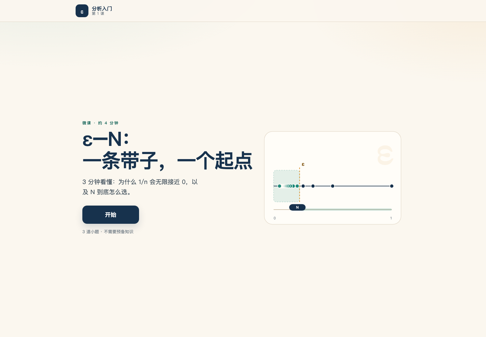
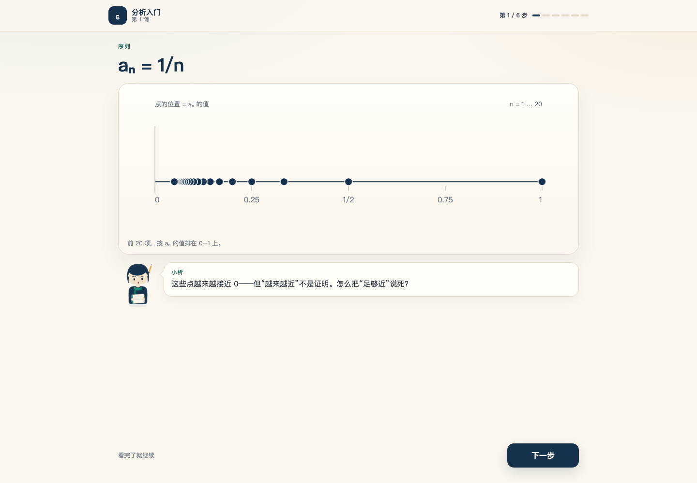
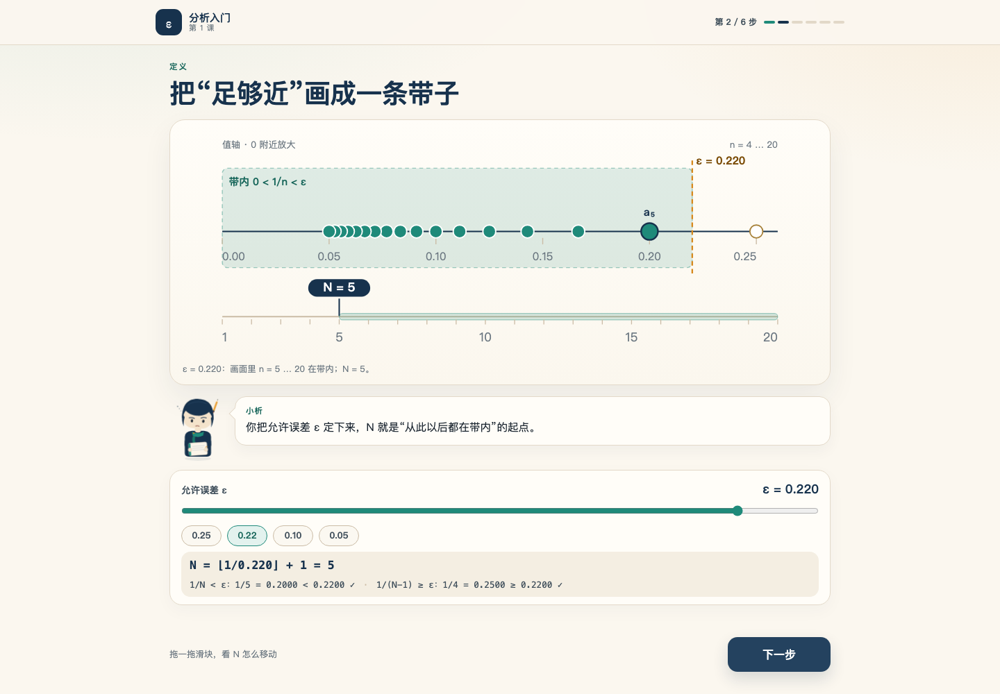
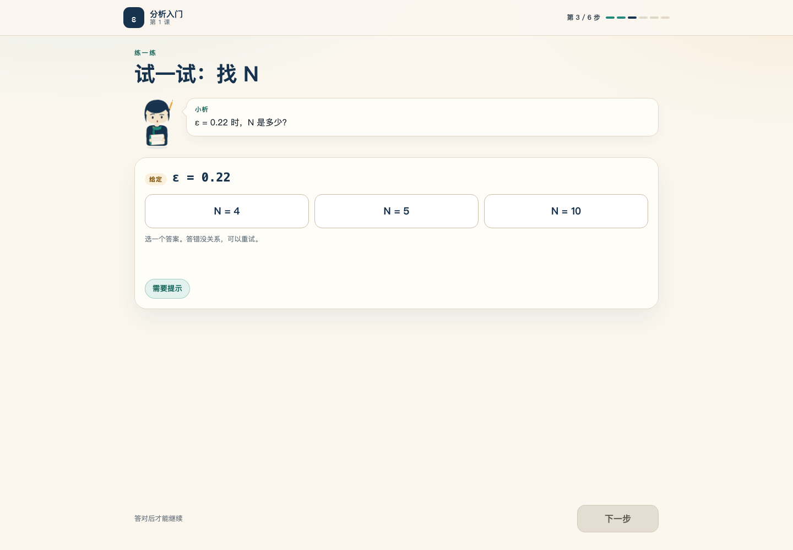
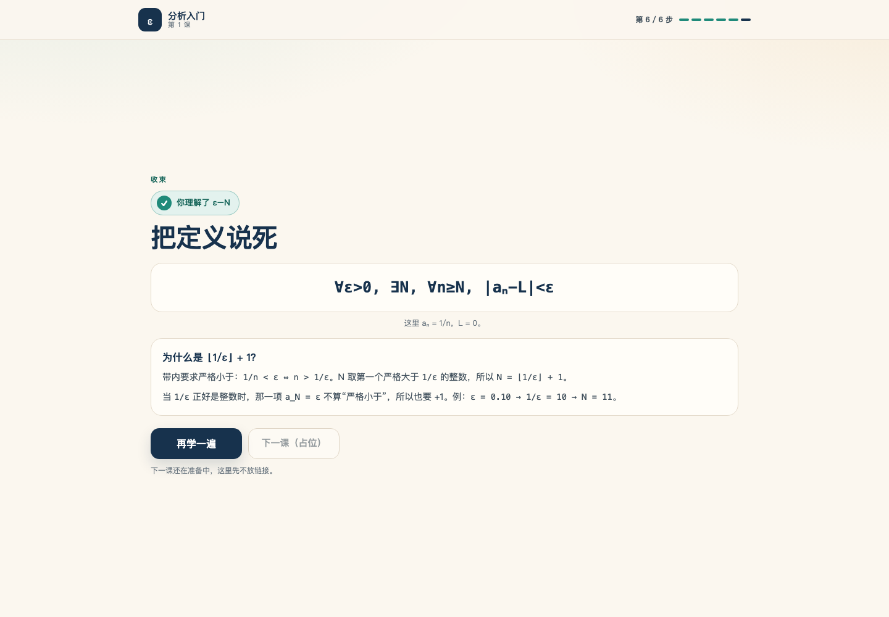
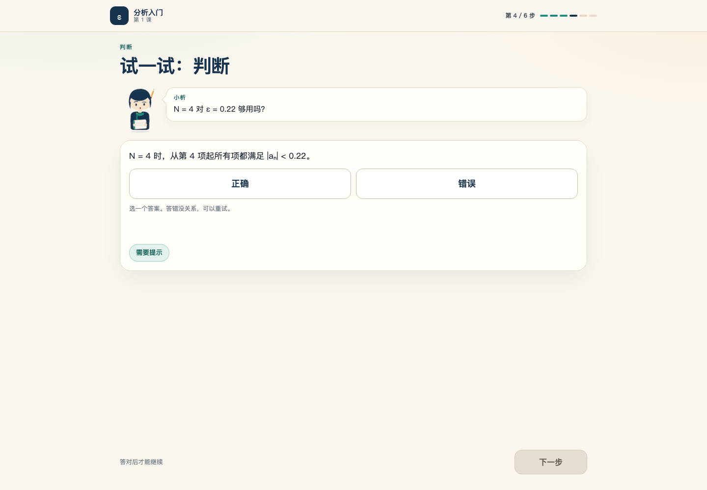
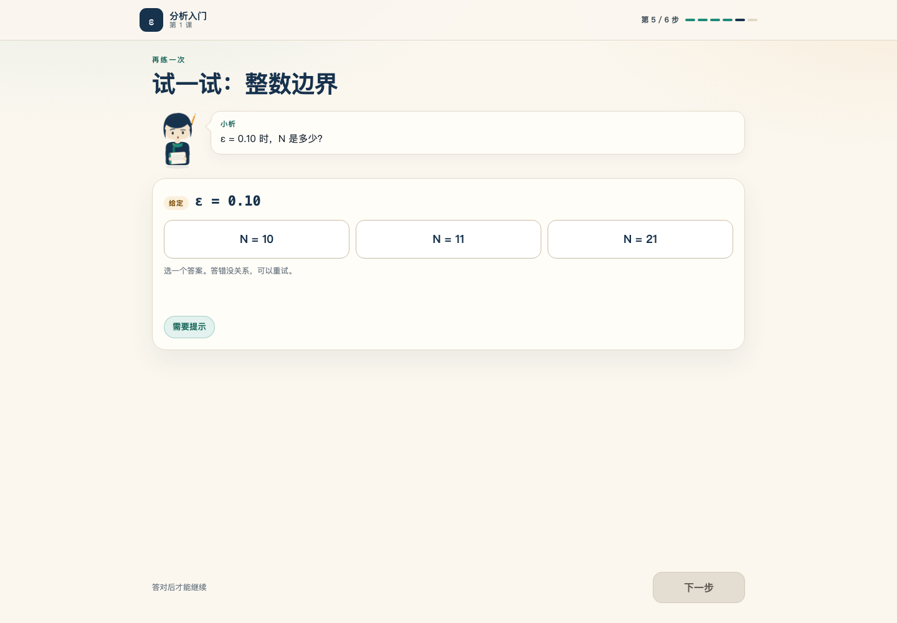

# 完整的一课：ε–N（3–5 分钟）

> **C8.3 产品样张，不是课程单元。**
> 一个线性、可从头走到尾的微课：`aₙ = 1/n → 0` 的 ε–N 定义。
> 只新增 `scripts/lesson_complete/**`；没有改 `courses/`、kernel、front、CI、docs。

- **页面**：`scripts/lesson_complete/index.html`（自包含，`file://` 可开）
- **评审副本**：`scripts/lesson_complete/preview/index.html`（与 `index.html` 逐字节相同）
- **预览**：<https://raw.githack.com/ColorlessBoy/sokonanoda-lang/62878e0d505c0efe998f604fb4cfbcbb663f449c/scripts/lesson_complete/preview/index.html>
- **范围**：一节课、一个概念、一个同伴、一条主路径。无 CDN、无外部字体、无图片、无 npm、无网络请求。

## 为什么这是一节“课”，不是又一个探针

上一版演示把所有东西放在同一页：角色切换、角色圣经、场景、五道游戏题、XP/连对、调试读数。它能证明零件存在，但陌生人不知道从哪里开始，也不知道什么时候结束。

这一版只回答产品问题：**一个第一次打开页面的学习者，能不能不追问“我该点哪里”，在 3–5 分钟内走完一课？**

- **一次只有一屏**：7 个 screen 中只有当前一屏可见；没有“全部内容往下滚”。
- **每一步一个主动作**：`开始` 或 `下一步`；答题步的“下一步”在答对前是禁用的。
- **一个同伴**：只有小析，带对话气泡；阿理只藏在“需要提示”后面，一次一行，不出现角色面板。
- **一条练习线**：3 道题（2 道单选 + 1 道判断），每题都有错答重试、即时反馈和一行提示。
- **一个收束**：形式定义、`N = ⌊1/ε⌋ + 1` 的严格边界解释、徽章“你理解了 ε–N”、重播与禁用的下一课占位。
- **没有**：角色切换、角色圣经、XP/连对/积分、完成百分比、调试面板、散落公式、下一课死链。

## 7 屏流程

| # | screen | 学习者看到什么 | 主动作 |
|---|---|---|---|
| 0 | cover | 标题“ε–N：一条带子，一个起点”、一句承诺、装饰性带子/点图 | **开始** |
| 1 | sequence | `aₙ = 1/n` 的前 20 个点依次落向 0；小析问“越来越近为什么不是证明” | **下一步** |
| 2 | band | 0 附近放大的误差带；ε 滑块（0.001–0.25）+ 4 个预设；N 起点线；`N = ⌊1/ε⌋ + 1`；`1/N < ε` 与 `1/(N−1) ≥ ε` | **下一步** |
| 3 | q1 | ε = 0.22，N 是多少？4 / 5 / 10 | 答对后 **下一步** |
| 4 | q2 | “N = 4 对 ε = 0.22 够用吗？”正确 / 错误 | 答对后 **下一步** |
| 5 | q3 | ε = 0.10，N 是多少？10 / 11 / 21 | 答对后 **下一步** |
| 6 | summary | 形式定义、严格边界、徽章、再学一遍、禁用的下一课（占位） | **再学一遍** |

封面不计入 step；其余 6 屏在顶栏显示小号“第 x / 6 步”。

## 数学：唯一公式与严格边界

```text
|aₙ| < ε  ⇔  1/n < ε  ⇔  n > 1/ε
N = ⌊1/ε⌋ + 1        （即使 1/ε 是整数，也要 +1）
```

| ε | 1/ε | N | 边界 |
|---:|---:|---:|---|
| 0.25 | 4 | **5** | `a₄ = 0.25 = ε`，不算严格小于 |
| 0.22 | 4.545… | **5** | `a₅ = 0.2 < 0.22`，`a₄ = 0.25 ≥ 0.22` |
| 0.10 | 10 | **11** | `a₁₀ = 0.10 = ε`，不算严格小于 |
| 0.05 | 20 | **21** | `a₂₀ = 0.05 = ε`，不算严格小于 |
| 0.001 | 1000 | **1001** | 前 20 项全在带外；定义仍从 n = 1001 起成立 |

- `math.js` 是页面、构建与检查共用的唯一数学源；`app.js` 不复制 `computeN`。
- 带内判定是 `1/n < ε`（严格小于），不是 `≤`。
- 当 ε 变小时，画面里的项**退出**带子（不是进入），序号轴上的 N **向右**移动；这与 `1/n → 0` 的几何方向一致。
- 画面只画 `n = 4 … 20`（值轴放大到 0–0.26）。当 N > 20 时，页面明确写“N 已在序号轴外”，不把 20 项冒充整条序列。

### 三道题

| 题 | 题目 | 正确 | 关键反馈 |
|---|---|---|---|
| Q1 | ε = 0.22 → N？4 / 5 / 10 | **5** | `1/0.22 ≈ 4.545`，第一个严格大于它的整数是 5；`a₅ = 0.2 < 0.22` |
| Q2 | N = 4 对 ε = 0.22 够用吗？正确 / 错误 | **错误** | `1/4 = 0.25 ≥ 0.22`，第 4 项还在带外 |
| Q3 | ε = 0.10 → N？10 / 11 / 21 | **11** | `1/0.10 = 10` 是整数；`a₁₀ = 0.10` 不算 `< ε`，所以 +1 |

- 答错：反馈标红、保留本题、允许重试；“下一步”仍然禁用；不扣分、不锁题。
- 答对：反馈标绿、选项锁定、提示按钮禁用、焦点落到“下一步”；**不自动跳屏**，学习者自己按。
- 提示：点“需要提示”只显示一行阿理的提示；再点可收起；没有阿理角色卡或立绘。

## 视觉与交互

- **一个同伴**：小析 SVG（圆短发、青绿围巾、笔记本 + 铅笔），五种表情 `curious / thinking / happy / oops / neutral`。表情只在数学/答题状态切换时变化。
- **气泡，不是语音**：每条台词只做一个动作——指认、追问、提示或确认；没有装饰性闲聊。
- **场景**：沿用探针的 ε–N 视觉语言（数轴、带子、ε 虚线、N 起点线、序号轴），但只在一屏里出现；没有“全景 + 放大 + 控制台”同屏的探针感。
- **进度**：顶栏一个小号“第 x / 6 步”+ 6 段细条；没有百分比、没有 XP/连对。
- **按钮**：开始/下一步是大号实心按钮；在手机上占满一行；题目选项是大号原生 `<button>`。
- **键盘**：`Tab` 到控件，`Enter/Space` 激活；选项组支持 `↑/↓/←/→` 移动焦点；ε 滑块支持方向键；每一步切换后焦点落到标题。
- **屏幕阅读器**：题目提示、反馈、阿理提示与全局播报都是 `aria-live="polite"`；反馈 `aria-atomic`；错选项 `aria-invalid`；滑块 `aria-valuetext` 含当前 N。
- **减少动态**：`prefers-reduced-motion: reduce` 下所有动画/过渡关闭，序列点立即显示，不播放落点动画。
- **零横向溢出**：1440×1000 与 390×844 都逐屏检查 document/body 宽度与每个可见 HTML 元素；每屏高度也不超过一个视口（无长滚动）。
- **无外部资源**：没有 `<link>`、``、`<iframe>`、`fetch`、XHR、WebSocket、Worker、动态 `import()`、`eval`。页面只从 `file://` 读取自身。

## 打开、构建、验收

```bash
open scripts/lesson_complete/index.html          # 本地 file://，无需服务器
node scripts/lesson_complete/build.mjs           # 重新生成 index.html + preview
node scripts/lesson_complete/build.mjs --check   # 只校验提交产物是否漂移
node scripts/lesson_complete/check.mjs           # 静态 + 真 Chrome，rc=0 才算通过
node scripts/lesson_complete/check.mjs --json    # 机器可读摘要
node scripts/lesson_complete/check.mjs --no-browser
```

Chrome 默认取 `/Applications/Google Chrome.app/...`；其他平台用 `SOKO_CHROME=/path/to/chrome` 覆盖。检查脚本不安装任何东西。

`check.mjs` 三层：

1. **静态/构建**
   - 提交的 `index.html` 必须等于从 `template.html + styles.css + math.js + app.js + content.json` 重新渲染的字节；`preview/index.html` 与它逐字节相同。
   - 恰好 7 个 screen、顺序固定；封面是唯一静态可见屏；每屏恰好一个 `.btn-primary`；6 个进度段；3 道题、选项集合、提示/反馈 aria 结构。
   - 精确文案（封面标题/承诺、两条气泡、徽章、形式定义、严格边界说明）。
   - 无外链、无 `<a>`、无表单/文本输入、无 textarea/contenteditable、无 CDN/字体/图片/网络 API。
   - **250 个千分位 ε + 12 个额外 ε**：独立参考实现校验 `N`、`1/N < ε`、`1/(N−1) ≥ ε`、最小性、带内项数、整数倒数边界；另有负例契约测试（删提示、改答案、缺题、缺选项都必须被拒）。
2. **浏览器（真 headless Chrome，`file://`）**
   - 7 屏只有 1 屏可见；真实鼠标点 `开始`，一路点到 summary；错误答案不前进、不奖励；提示一次只出一行；正确后不自动前进，必须点“下一步”。
   - 250 个滑块值的 `N`、严格检查、公式、`aria-valuetext` 与页面显示逐项核对。
   - ε 从 0.22 缩到 0.10 时，`a₅` 退出带子、`a₁₁` 进入、N 线向右、带子变窄；0.25/0.05/0.001 边界各测一次。
   - Q1/Q2/Q3 的真实点击 + 键盘路径（Tab/Enter/Arrow）都走一遍。
   - 1440×1000 与 390×844：逐屏零横向溢出、每屏不超过一个视口；减少动态下零运行中动画；零 http(s) 请求、零 console/page error。
3. **截图**：写到 `/tmp/lesson-complete-{cover,sequence,band,q1,q2,q3,summary}.png`；`SOKO_UPDATE_SHOTS=1` 时同步刷新 `screenshots/` 里提交的代表图。

本次验收（生成物 `sha256` 见 `build --check` / `check --json`）：

```text
node scripts/lesson_complete/build.mjs --check   # rc=0
node scripts/lesson_complete/check.mjs           # rc=0
# static: 1457 checks · browser: 335 checks · 0 failures
```

## 文件

```text
scripts/lesson_complete/
  content.json          3 道题的答案键、提示、反馈（不含题干/角色）
  template.html         7 屏结构 + 小析 SVG 模板 + 精确文案
  styles.css            纸/墨调色板、响应式、减少动态
  math.js               UMD：computeN / strictChecks / 带内判定（页面与 Node 共用）
  app.js                SPA 状态机：屏幕、滑块、答题、提示、重播
  index.html            自包含生成物
  preview/index.html    逐字节副本（raw.githack）
  build.mjs             CLI：构建 / --check
  check.mjs             CLI：静态 + 浏览器 / --json / --no-browser
  lib/{page,cdp,verify-static,verify-browser}.mjs
  screenshots/*.png     代表截图
  README.md             本文件
```

## 截图

| cover | sequence |
|---|---|
|  |  |

| band | q1 |
|---|---|
|  |  |

| summary | q2 / q3 |
|---|---|
|  |   |

## 复用与边界

- 只读借鉴了 `/tmp/soko-learn-demo/scripts/learn_demo/` 的 ε–N 场景几何、小析 SVG 与“严格小于”数学；`/tmp/soko-avatar/scripts/avatar_proto/` 的角色表情机制；`/tmp/soko-anim/scripts/anim_proto/` 的“值轴 / 序号轴 / N 向右”视觉关系。没有修改那些分支/worktree。
- 只新增 `scripts/lesson_complete/**`；没有课程、kernel、front、CI、docs 改动。

## 已知限制

- **答案校验是静态 JS**：`content.json` 是答案键，`math.js` 复核；没有接入课程内核/WASM，不能在这里写或判 Lean 证明，也不产生 `decl.checked`。
- **没有语音**：只有文字气泡；没有 TTS、没有音频、没有真人出镜。
- **只有一节课**：`aₙ = 1/n → 0`；没有课程目录、没有账号、没有持久化，刷新即重置。
- **下一课是占位**：`下一课（占位）` 是禁用按钮，不是链接；不会 404。
- **画面只画 20 项**：`n > 20` 时 N 在序号轴外，页面会明说；定义仍对全部 n 成立。
- **无内核/后端**：没有 `decl.checked`、没有成绩单、没有埋点；这是产品样张，不是课程单元。
